# Draft metabolic maps from the BRENDA map

`ecmapper.draft_map` turns the matches of a model to the BRENDA map (see [README.md](README.md#finding-model-reactions-on-a-brenda-map))
into a draft map of the model: the subsystems of the BRENDA map that contain model reactions (without subsystems whose
model reactions are all drawn in other subsystems; those are set aside on a separate map), reduced to the enzyme
nodes with model reactions, completed with model reactions that connect drawn metabolites, condensed and arranged with
few crossings of the inter-pathway links, or (`--pack`) packed into as little space as possible without inter-pathway
links. The subsystem boxes and names are kept. With `--split`, the map is split into a central map and auxiliary
maps, one per BRENDA colour group, with an overview of the maps. Outputs: an SVG in the style of the
BRENDA map, an Escher map for editing, and box positions for CNApy.

The results for iML1515 are in [BRENDAmap/draft_map_iML1515](BRENDAmap/draft_map_iML1515).

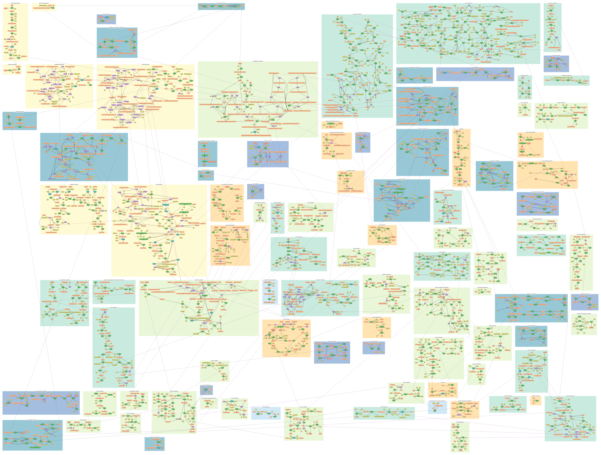

## Usage

```bash
python -m pip install -e "./ecmapper[draft-map]"   # numpy, scipy, numba, networkx, pygraphviz
cd ecmapper
# 1. match the model to the map (BiGG's SBML files have no subsystems: take them from the JSON file)
python -m ecmapper.draft_map.prepare iML1515.xml BRENDAmap/BRENDA_map_reactions.json iML1515_prep.pkl \
    --subsystems iML1515.json
# 2. build the draft map
python -m ecmapper.draft_map.run iML1515_prep.pkl BRENDAmap/BRENDA_map_reactions.json BRENDAmap/BRENDA_map.svg OUT \
    --hub-subsystems 6 --iterations 200000 --seed 2
# or without inter-pathway links, the subsystems packed into as little space as possible
python -m ecmapper.draft_map.run iML1515_prep.pkl BRENDAmap/BRENDA_map_reactions.json BRENDAmap/BRENDA_map.svg OUT_PACKED \
    --pack --iterations 200000 --seeds 4
# or split into a central map and auxiliary maps, each packed without inter-pathway links
python -m ecmapper.draft_map.run iML1515_prep.pkl BRENDAmap/BRENDA_map_reactions.json BRENDAmap/BRENDA_map.svg OUT_SPLIT \
    --split --pack --iterations 200000 --seeds 4
```

`iML1515.xml` and `iML1515.json` are from [BiGG](http://bigg.ucsd.edu/models/iML1515). The first step takes about
20 s with the resource files cached, the second two to three minutes. Options of `run`:

| Option | Default | |
|---|---|---|
| `--keep-subsets` | | keep subsystems whose model reactions are a proper subset of another subsystem's (rule A, step 1) |
| `--keep-borrowed` | | keep subsystems whose model reactions are all drawn in other subsystems that have model reactions of their own (rule B, step 1) |
| `--aside-coverage F` | 0.9 | set aside subsystems of which ≥ F of the model reactions are in other subsystems (rules C, D); 1: only fully covered ones, > 1: off |
| `--aside-min-matched F` | 0 (off) | set aside subsystems in which < F of the enzyme nodes have model reactions (rule E) |
| `--relayout` | `place_template` | step 3b (see 1.3): `place_template` adds only the added reactions that go where a node of the BRENDA map with their EC number or reaction ID was; `place_conservative` those that cross nothing and leaves out the others, no other layout; or the layouts tried, comma-separated from `place,spring,fdp,dot,neato`; `none`: keep the positions of step 3 |
| `--layout-of ID=LAYOUT,...` | | step 3b: the layout of these subsystems, chosen by hand (names as in `--compare-layouts`, e.g. `citric-acid-cycle=place,lipid-metabolism=spring+untangle`), whatever `--relayout` chooses; set by *Compare layouts* in the GUI. Only here: `autolayout` (sbml-autolayout, see 1.3) |
| `--compare-layouts IDS` | | write all layouts of step 3b of these comma-separated BRENDA subsystem IDs side by side (`OUT_DIR/layouts/index.html`, one SVG each, with crossings and the reactions left out) after step 3, and stop (in the GUI: *Compare layouts*) |
| `--label-length N` | 12 | shorten metabolite labels longer than N characters: to the BiGG ID (nodes of one model metabolite), else cut with "…"; the full name stays the tooltip; 0: never |
| `--relayout-margin` | 0.25 | step 3b: `dot` and `neato` (which change the BRENDA drawing) need at least this fraction fewer crossings |
| `--relayout-min-gain` | 3 | step 3b: `dot` and `neato` also need at least this many fewer crossings (see 1.3) |
| `--no-untangle` | | step 3b: do not also try each layout untangled locally (see 1.3) |
| `--no-outside` | | step 3b: do not prefer places outside a cycle of the BRENDA drawing for added reactions at the cycle (see 1.3) |
| `--circle IDS` | | step 3b: comma-separated BRENDA subsystem IDs whose cycle of main metabolites is drawn on a circle (see 1.3), e.g. `citric-acid-cycle` |
| `--min-anchored` | 2 | drawn main metabolites a model reaction needs to be added (step 3) |
| `--no-completion` | | skip step 3 |
| `--compactness` | 0.5 | weight of compactness against keeping the drawing when condensing (step 4) |
| `--uniform-shrink` | on | step 4: after `--relayout place_conservative` or `place_template`, do not condense a subsystem but only shrink its drawing by one factor per axis, so that its nodes keep their arrangement (see 1.4); `--no-uniform-shrink` condenses it |
| `--hub-subsystems N` | 0 (off) | remove the inter-pathway links of metabolites drawn in at least N subsystems (step 5) |
| `--iterations`, `--seed`, `--seeds` | 20000, 1, 1 | annealing of the arrangement (step 6); with `--seeds k` the best of k runs is kept |
| `--gap` | 80 | space between subsystem boxes |
| `--flips {none,x,xy}` | none | allow mirroring subsystems (left–right, also upside down) |
| `--pack` | | instead of steps 5 and 6: drop the inter-pathway links and pack the subsystems into as little space as possible (see [3.4](#34-packed-without-inter-pathway-links---pack)); not with `--hub-subsystems`, `--flips`, `--compare-flips`, `--extra` |
| `--split` | | split into a central map and auxiliary maps, each arranged on its own (see [3.5](#35-split-into-a-central-map-and-auxiliary-maps---split)); not with `--compare-flips`, `--extra` |
| `--central IDS` | see 3.5 | with `--split`: comma-separated BRENDA subsystem IDs of the central map |
| `--maps FILE` | | with `--split`: JSON file `{map name: [BRENDA subsystem IDs]}` of further maps (before the central map; the other subsystems go to the map of their colour group) |
| `--min-map-reactions` | 25 | with `--split`: colour group maps with fewer model reactions are merged into the map they have most links with |
| `--write-assignment XLSX` | | with `--split`: write the maps of the subsystems and the subsystems of the model reactions as an editable table after step 3 and stop (see [3.5](#35-split-into-a-central-map-and-auxiliary-maps---split)) |
| `--assignment XLSX` | | with `--split`: take the maps of the subsystems, the subsystems of the model reactions and the arrangement of maps arranged by hand from the (edited) table of `--write-assignment` or the GUI; replaces `--central`, `--maps`, `--min-map-reactions` |
| `--escher-scale` | 2 | scale of the Escher map relative to the BRENDA map (see [5](#5-escher-export)) |
| `--escher-no-labels` | | no subsystem names in the Escher map |
| `--compare-flips`, `--extra graphviz elk user-order` | | further arrangements for comparison (`map_*.svg`, `stats.json`); Graphviz needs pygraphviz, ELK needs `node` with `elkjs` on `$NODE_PATH` |

Outputs in `OUT`:

| File | |
|---|---|
| `draft_map.svg` | the draft map in the style of the BRENDA map; reaction IDs below the enzyme nodes, model reactions in the tooltips |
| `draft_map.escher.json` | Escher map (see [Escher export](#5-escher-export)) |
| `draft_map.maps` | CNApy box positions `{reaction ID: [x, y]}` for `draft_map.svg` as background |
| `set_aside.svg`, `.escher.json`, `.maps`, `.reaction_positions.json` | the subsystems set aside in step 1 (see 1.1), on a map of their own |
| `reaction_positions.json` | positions of the enzyme nodes of each drawn model reaction |
| `added_reactions.json` | the model reactions added in step 3, with subsystem, position and drawn metabolites |
| `step1_subsystems.svg`, `step2_pruned.svg`, `step3_completed.svg`, `step3b_relayout.svg` | the map after steps 1–3b (original arrangement) |
| `map_*.svg` | the arrangements compared |
| `stats.json` | counts after each step, hub metabolites, metrics of the arrangements, coverage of the model |
| `draft_map.pkl` | the final `DraftMap` |

With `--split`, `OUT` has instead of the `draft_map.*` files, for each map (file prefix: the map name in lower case,
e.g. `central_metabolism`): `<map>.svg`, `<map>.escher.json`, `<map>.maps`, `<map>.reaction_positions.json`,
`<map>.pkl` (the set-aside subsystems are the last map, `set_aside`); and `overview.svg` (the overview, see 3.5; the map names link to the SVGs), `maps.json` (the subsystems
and model reactions of each map, the metabolites linked across maps) and `stats.json` (per map in `maps`).

Enzyme nodes: green: model reaction on the map; cyan: found in the vicinity search; violet, dashed: added from the model
(step 3). Metabolite nodes added in step 3 are dashed, hub metabolites (step 5) have a red border. Inter-pathway links
are dashed grey lines (purple: added in step 3).

`scripts/svg_to_png.js` renders an SVG (or a part of it) as PNG, `scripts/render_escher.js` loads an Escher map with a
model in Escher, saves a screenshot and reports reactions and metabolites missing in the model (both need playwright).

## 1. Method

| Step | What | How |
|---|---|---|
| 0 | Match the model to the map | `prepare`: `MapMatcher` (vicinity search `propagate`); stores the matches, the keys of model and map metabolites, the reactions with stoichiometry, direction, genes and subsystem |
| 1 | Drop subsystems without model reactions; drop or set aside redundant ones | see 1.1 |
| 2 | Remove enzyme nodes without model reactions | also the metabolite nodes that only they use; inter-pathway links through removed metabolite nodes are bridged |
| 3 | Complete the network with model reactions that are not on the map | see 1.2 |
| 3b | Lay out the subsystems with added reactions again | default: the added reactions placed next to their metabolites only where they cross nothing, the others left out; or the added nodes placed again, networkx and Graphviz layouts, the one with the fewest crossings kept; see 1.3 |
| 4 | Condense each subsystem | order-preserving LP compaction, see 1.4; box and title fitted around the drawing |
| 5 | Disconnect hub metabolites | the inter-pathway links of metabolites drawn in ≥ N subsystems are removed; their nodes stay and are marked |
| 6 | Arrange the subsystems with few crossings of inter-pathway links | simulated annealing over sequence pairs, see 1.5 |
| 7 | Output | main edges that pass through other nodes routed around them (see 1.6); SVG, Escher map, CNApy box positions, reaction positions |

The subsystems are arranged last, although the original idea was to arrange them right after dropping the empty
ones: the arrangement needs the final box sizes and the positions of the linked metabolites in the boxes, and both
change with pruning, completion and condensation. Arranging first and condensing afterwards (`--extra user-order`)
ends with 1.6× the crossings (276 vs. 173 for iML1515) and a 23% larger area, because the boxes shrink after the
arrangement was optimised.

With `--pack`, the inter-pathway links are removed after step 4 and steps 5 and 6 are replaced by a packing of the
boxes: the annealing of 1.5 without links, which leaves only the area and the aspect ratio in the cost. Before step 4,
the few edges of the BRENDA map from an enzyme node to a metabolite node in another subsystem are made local (they
would cross the packed boxes): the edge is removed if the enzyme node has the metabolite in its own subsystem,
otherwise the metabolite gets a copy next to the enzyme node.

With `--split`, the edges are made local as for `--pack`, and after step 4 the subsystems are assigned to maps and
steps 5 and 6 run for each map; see [3.5](#35-split-into-a-central-map-and-auxiliary-maps---split).

Set-aside subsystems (1.1) go through steps 2 and 4 like the others but are not used by the completion (step 3); after
step 5 they are moved to a map of their own (with `--split`: the last map), arranged like the main map. Links between
them and the main map become references as with `--split`.

Inter-pathway links considered: the BRENDA `inter-pw-link`s (same compound in two subsystems, hidden in the BRENDA
SVG) whose both ends are main metabolites of enzyme nodes with model reactions, plus the links added in step 3.

### 1.1 Redundant subsystems (step 1)

The BRENDA map draws some steps in several subsystems, so some subsystems only repeat model reactions that are
drawn elsewhere (e.g. "photosynthesis" repeats the Calvin cycle steps of glycolysis and the pentose phosphate
pathway, "C4 and CAM carbon fixation" the anaplerotic steps of gluconeogenesis). With the model reactions of a
subsystem being those of its enzyme nodes after step 1, and a reaction being a subsystem's *own* if no other
remaining subsystem draws it:

| Rule | Subsystems | Action | Option |
|---|---|---|---|
| A | model reactions are a proper subset of those of one other subsystem | removed | `--keep-subsets` turns it off |
| B | all model reactions are also in other remaining subsystems that have model reactions of their own | removed | `--keep-borrowed` turns it off |
| C | all model reactions are also in the other remaining subsystems | set aside | `--aside-coverage 1` (only C) |
| D | ≥ 90% of the model reactions are also in the other remaining subsystems | set aside | `--aside-coverage 0.9` |
| E | < F of the enzyme nodes have model reactions | set aside | `--aside-min-matched F`, off by default |

Rule B asks of each reaction that a subsystem shares with others whether it has a home elsewhere: a subsystem whose
reactions are all borrowed from subsystems that have reactions of their own adds nothing and is removed, whereas a
subsystem with one reaction of its own (e.g. photosynthesis in a plant model, with RuBisCO) stays. For e_coli_core,
photosynthesis (10 reactions, all in glycolysis, gluconeogenesis and the pentose phosphate pathway) and C4 and CAM
carbon fixation (6 reactions, all in gluconeogenesis, glycolysis, the citric acid cycle and alanine metabolism) are
removed, while acetyl-CoA biosynthesis (PDH, drawn also in the oxidative decarboxylation of pyruvate, which has no
other reaction) is only set aside by rule C. Rule B goes through the subsystems from the smallest (fewest model
reactions; ties by ID) and removes one at a time, as the reactions of a removed subsystem may become the own
reactions of another one; the result lists for each removed subsystem the subsystems with own reactions that draw
its reactions (`drawn_in`).

C and D go through the subsystems from the smallest and compare each with the
subsystems not yet set aside, so of two subsystems with the same reactions one stays. The set-aside subsystems are
drawn on a separate map, from which they can be copied back. A model reaction drawn only in set-aside subsystems (rule
D) is a candidate of the completion (step 3) and may be added to the main map.

Rule E is off because the fraction of matched enzyme nodes does not tell redundant subsystems from real ones: the
BRENDA subsystems are generic, so for iML1515 tryptophan (16%) and lysine metabolism (18%) have lower fractions than
photosynthesis (50%).

### 1.2 Completion with model reactions (step 3)

Candidates: model reactions not on the map, without boundary reactions and transporters (as ecmapper defines them),
whose main metabolites (no currency metabolites, carriers such as ACP, thioredoxin, quinones, protons) are in one
compartment. A drawn metabolite node "is" a model metabolite if it is a main metabolite of an enzyme node whose model
reaction contains the metabolite with a common key (KEGG compound, normalised name), as in ecmapper's matching.

- A candidate is added if ≥ 2 (`--min-anchored`) of its main metabolites are drawn, at least one of them by a node
  of the map (not only by a node added for an earlier candidate). Repeated until nothing changes. So reactions close
  gaps between drawn metabolites or extend the map by one step; chains far away from the map are not built (without
  this condition, 205 reactions, mostly lipid chain variants, piled up in purine metabolism for iML1515).
- Subsystem: the one with most of the reaction's drawn main metabolites; ties: the subsystem of the reaction's best
  `related` node (same EC number or reaction ID, other metabolites), the BRENDA subsystem in which most model
  reactions of the same model subsystem are drawn, the nearest subsystem.
- Position: the original place of the best `related` node in that subsystem (removed in step 2, or still on the map
  because another model reaction matches it: then next to it), otherwise between the drawn metabolites (free place
  by spiral search). Main metabolites drawn only in other subsystems get a new node, linked to the nearest drawn
  node (an inter-pathway link); metabolites not on the map get a new node; cofactors get cofactor nodes. Arrows
  follow the model's reversibility.
- Variants (same drawn nodes, reaction or new metabolite IDs equal apart from digits, e.g. chain lengths
  `PLIPA2E160pp`, `PLIPA2E161pp`) share one node labelled `PLIPA2E160pp (+1)`.

### 1.3 Layout of subsystems with added reactions (step 3b)

The completion places added reactions between their drawn metabolites; where many reactions are added (e.g. the
phospholipid turnover in lipid A biosynthesis), this gives long edges that cross the drawing.

**Template-based placement (`place_template`, the default).** The BRENDA drawing stays as it is and only gets
reactions that fit into it without a crossing (`relayout.place_conservative`). As with `place` (below), the added
enzyme nodes are placed one at a time, the one with the most partners already placed first, each with its new
metabolite nodes and its cofactors. A node only goes to a point of a 45-unit grid within 2 reaction steps (660 units)
of its ideal point (as for `place`) where none of its links crosses a link drawn so far (main metabolites and
cofactors) or passes through a node, no drawn link passes through it, and its box (with room for its model
reactions) keeps 12 units from the others; points outside the drawing count, so the drawing may grow. The enzyme
node takes the free point nearest to its ideal point (inside a cycle of the BRENDA drawing counts as 1.5 steps
farther, see below), its new metabolites the nearest to theirs, its cofactors the nearest to where they were
relative to it; if one of them does not fit, the next of 30 points of the enzyme node is tried. Reactions that fit
nowhere are left out of the map (their enzyme nodes, cofactors, the metabolite nodes only they use and the
inter-pathway links of these); `stats.json` lists them per subsystem (`relayout` → `left_out`). Reactions put into a
subsystem by hand in the assignment table are drawn anyway, where step 3 put them. No other layout follows, and step
4 condenses such a map without adding crossings (see 1.4). On iML1515 (GUI project, `--iterations 2000 --seed 2`):

| | `place,spring,fdp,dot,neato` (before) | `place_conservative` |
|---|---|---|
| added model reactions drawn | 297 | 199 (98 left out) |
| crossings of main-metabolite links in the 61 subsystems after step 3b | 278 | 12 (all of the BRENDA drawings) |
| crossings after step 4, main metabolites / all links | 279 / 556 | 13 / 23 |
| drawing area after step 4 (M units²) | 64.3 | 82.9 |
| subsystems whose BRENDA part is drawn differently | 5 (`dot`, `neato`) | 0 |

Without the limit of 2 steps, 80 reactions were left out, but some went far out with links across the whole
subsystem (arachidonate biosynthesis). Cofactors placed one by one instead of moved with their enzyme node (mirrored
at most) save 26 reactions. Step 3b takes about 8 s.

**Template places only (`place_template`).** A model reaction whose EC number or reaction ID is on the BRENDA map,
but whose node was not matched (another cofactor pair, or metabolites a bit different: score below 0.6, or more than
0.1 below the best match; status `related`), loses that node in step 2 and comes back in step 3 as an added
reaction. Step 3 now records the place of such a node that is not drawn any more, in the subsystem the reaction is
added to (`Completion.template_spot`), and for its new metabolite nodes and cofactors the places of the node's
metabolites (`Completion.template_met`: a common key; a cofactor without one takes a template cofactor of its side,
consumed or produced, that no other metabolite of the reaction has, e.g. GTP the place of ATP). `--relayout
place_template` (used alone) draws only the added reactions that can go exactly there: each new metabolite node has
a free template place, too, and the links from there (to the metabolites drawn already and to the cofactors) cross
no link and pass through no node (`relayout.place_template`); all other added reactions are left out (`stats.json`:
`relayout` → `left_out`), reactions put into a subsystem by hand stay. As after `place_conservative`, condensing adds
no crossings. On iML1515 this keeps 1 of the 297 added reactions (GLCS1, at the place of 2.4.1.21 in glycogen
metabolism; 12 / 24 crossings after step 4, 56.2 M units²). Of the 282 added enzyme nodes, 146 have no node with
their EC number or reaction ID on the map, 93 have one only in another subsystem (in 80 of them none of their
metabolites is drawn there; 11 of these subsystems were dropped in step 1), 13 have one that is still drawn (it
matched another model reaction), 22 have new metabolites that the template node does not have, and 7 more would
cross the drawing from the template place (e.g. MLTG2 at the place of 3.2.1.3, whose metabolites are drawn far
away). Drawing these reactions in their template subsystem with the template node's metabolites would be the next
step.

**Layouts that compete.** With layouts in `--relayout` instead, step 3b lays out each subsystem with added reactions
again with five layouts of its enzyme and main metabolite nodes (an enzyme node with its cofactors counts as one box,
with room for its model reactions as in step 4; the cofactors keep their offsets):

| Layout | Package | Keeps the BRENDA drawing |
|---|---|---|
| `place`: the added nodes placed again one by one next to their metabolites, the nodes of the BRENDA map fixed (see below); the other layouts start from it | – (numpy) | yes |
| `spring`: Fruchterman–Reingold spring layout of the added nodes, the nodes of the BRENDA map fixed | networkx | yes |
| `fdp`: the same with Graphviz `fdp`, the BRENDA nodes pinned | pygraphviz | yes |
| `dot`: Graphviz `dot`, layered (Sugiyama) along the reaction directions | pygraphviz | no |
| `neato`: Graphviz `neato` (Kamada–Kawai), starting from the current drawing, the BRENDA nodes pinned softly (see below) | pygraphviz | mostly |

Each layout (and the current drawing) is condensed as in step 4 and the one with the fewest crossings of
main-metabolite links is kept (ties: crossings of all links, area). `dot` and `neato`, which change the BRENDA drawing,
are only taken if they have at least 25% (`--relayout-margin`) and at least 3 (`--relayout-min-gain`) fewer crossings
than the best of the current drawing, `place`, `spring` and `fdp`. The absolute minimum matters at small counts: with the
relative margin alone, one crossing fewer (2 instead of 3) replaced the citric acid cycle of a GUI project of iML1515
by a layered `dot` drawing without its ring, and 12 of the 22 subsystems redrawn in that project were redrawn for a
gain of 1–2 crossings (with the minimum gain of 3: 10 redrawn, 239 → 253 crossings of main-metabolite links in the
61 subsystems laid out again). `--relayout` selects the layouts (`none`: skip the step); layouts whose package is
missing are skipped.

**A layout chosen by hand only: `autolayout`.** The package
[sbml-autolayout](https://github.com/elixir2026-project22/small-pathway-layout) lays out small pathways by the
conventions of textbook maps: one straight main line (glycolysis if it is there, else the longest chain; long chains
fold into columns), known cycles (citric acid, urea, methionine and Calvin cycle) on circles, the rest as branches.
As `autolayout` it draws a single subsystem again, also one without added reactions: with `--layout-of
ID=autolayout` or *Use this layout* in the GUI's *Compare layouts*. It does not compete in `--relayout`, since it
discards the BRENDA drawing of the subsystem. Each enzyme node is passed as one reaction of the main metabolite
nodes at its main edges, each main metabolite node as a metabolite of its own with its name on the BRENDA map and
one of its model metabolites as ID (by these the package finds the known pathways and cycles; a cycle must be closed
along the reaction directions of the model, so e.g. a citric acid cycle with a 2-oxoglutarate synthase running
backwards is not drawn as a circle); only the node centres are taken back (3 × the coordinates of the package), the
cofactors keep their offsets to their enzyme node, and step 4 condenses the subsystem as after every layout, keeping
the circles of known cycles in shape (so the main line is no longer exactly straight). Subsystems with more than 150 enzyme nodes are not laid out (the run time grows fast: about 8 s at 70
reactions). Install it with `python -m pip install -e "./ecmapper[autolayout]"`; without the package the layout is
not offered, and a subsystem for which it was chosen keeps its drawing (the log says so).

**Soft pinning (`neato`).** Between `fdp` with the BRENDA nodes pinned and a free `neato`, each node of the BRENDA map
gets a pinned ghost node (a point) at its place, joined to it by an edge of 72 points and weight 5
(`relayout.graphviz_spec(soft=5, drift=72)`): it may drift a little to make room but not wander across the
subsystem. Graphviz's default mode for `neato` (stress majorisation) cannot be used with it: in 7 of 61 subsystems of
iML1515 it moved the pinned ghosts to coordinates of 10¹⁸ (and with ghost edges below 0.1 inch it gives NaN), so
`neato` runs in Kamada–Kawai mode (`mode=KK`; `sgd` ignores the edge weights); overlaps are left to step 4 (removing
them would separate the nodes from their ghosts). Started from `place` in the 61 subsystems of iML1515:

| `neato` | drift of the BRENDA nodes, median / 90% / max (units) | crossings of main-metabolite links, `neato` alone |
|---|---|---|
| free (before) | 377 / 1,113 / 3,398 | 311 |
| ghost edge 7 points | 5 / 11 / 48 | 846 |
| ghost edge 36 points | 53 / 121 / 537 | 685 |
| ghost edge 72 points (default) | 118 / 257 / 952 | 546 |
| ghost edge 144 points | 192 / 431 / 1,414 | 447 |
| `place` (the start) | 0 | 349 |

The softer the pins, the more crossings `neato` resolves, but even at 144 points it stays behind `place`: with the
BRENDA nodes (nearly) fixed, the stress of `neato` pulls the added nodes to its edge length, not away from crossings
(hard-pinned `neato` gave 754–838). In step 3b with all layouts (`--relayout place,spring,fdp,dot,neato`), the
layouts kept have 246 crossings instead of 278, but `neato` is kept in 1 subsystem instead of 3, and `dot` in 4
instead of 2. Taken as a layout that keeps the BRENDA drawing (no `--relayout-margin`, untangled with the BRENDA
nodes pinned), it is kept in 8 subsystems, with 278 crossings in total.

**Incremental placement (`place`).** The BRENDA drawing is taken as fixed, and the added reactions are fitted into it
(`relayout.place_added`). The added enzyme nodes (with their cofactors) and the metabolite nodes not on the map are
placed one at a time, the node with the most partners already placed first (nodes of the map count as placed). Its
ideal point is the centroid of its placed partners or, with one partner, half a reaction step beyond it, away from
that partner's other neighbours, so that a chain of added reactions continues the flow; without a placed partner it
is where step 3 put it. Around the ideal point, rings of free points are tried (16 directions, 45 units apart, up to
20 rings; the box keeps 12 units from the boxes placed so far), and the point with the smallest
(crossings + links through nodes + inside the cycle) × 1.5 `STEP` + distance to the ideal point is taken, as for the
secondary metabolites of the PWL layouts (`pwl.layout.place_side_metabolites`). The greedy order sees only the links
to nodes placed before, so two rounds of refinement place each added node again with all its links, its current
point among the candidates. The placed drawing competes as `place` and is the start of `spring`, `fdp` and `neato`;
`current` is the drawing of step 3.

For the GUI project of iML1515 (61 subsystems with added reactions; `--iterations 2000 --seed 2`), with and without
`place`:

| | without `place` | with `place` |
|---|---|---|
| subsystems redrawn by `dot` or `neato` | 10 | 5 |
| subsystems kept as `place` | – | 22 |
| crossings of main-metabolite links, best layout keeping the BRENDA drawing (sum) | 395 | 327 |
| crossings of main-metabolite links, kept layouts (sum) | 247 | 278 |
| after step 4: crossings of main-metabolite links / of all links | 248 / 543 | 279 / 556 |
| after step 4: drawing area | 66.1 M units² | 64.3 M units² |

`place` alone brings the crossings of the 59 subsystems it moves from 1,242 (step 3) to 349, fewer than `spring` (485)
or `fdp` (562) alone; without the refinement it gave 575 (one round: 419, four: 374). The kept layouts have more
crossings in sum because subsystems that `dot` or `neato` redrew before keep their BRENDA drawing now, e.g. alanine
metabolism (`neato`, 3 crossings → `place`, 5) and lipid metabolism (`neato`, 61 → `place`, 90); arachidonate
biosynthesis (`neato`, 21 → `place`, 13) and the citric acid cycle (`outside+untangle`, 2 → `place`, 0) gain on both
counts. The placement takes about 7 s for all subsystems.

**Local untangling.** Each layout (and the current drawing) is also tried untangled, as `<layout>+untangle`, and
competes like the others (it counts as keeping or redrawing like the layout it starts from). As in the layouts from
PWL (PWL.md, `pwl.layout.untangle`; LAYOUT_LEARNINGS.md 2), Graphviz `neato` moves only the nodes at the ends of
crossing main-metabolite links, with the lengths of the links of the drawing, and keeps everything else pinned; a
round (at most 3) is kept only if it removes crossings. In `current`, `spring` and `fdp` the nodes of the BRENDA map
never move, so only added nodes are untangled. Boxes and cofactors are those of the other layouts.
`--no-untangle` turns it off. For iML1515 (command of [Usage](#usage), after step 4) untangling lowers the crossings
of main-metabolite links inside the subsystems from 255 to 239 and of all links from 503 to 480, at a smaller area
(65.6 M instead of 67.3 M units²); fewer subsystems are redrawn by `dot` or `neato` (19 instead of 23 in a separate
run of step 3b). It works where it runs: in the 23 subsystems in which it changed the current drawing, their
crossings fell from 987 to 405 (`fdp`: 146 → 103 in 15; `dot`: 230 → 120 and `neato`: 245 → 168 in 8 each). With
`--relayout-margin 0.5` (a redrawing layout only at half the crossings, as for the PWL layouts) and untangling, the
crossings are about those without untangling at 0.25, with 16 instead of 23 subsystems redrawn and about 6% less
area; without untangling, 0.5 gives a quarter more crossings.

**Added reactions outside a cycle.** The completion places an added reaction between its drawn metabolites, so a
reaction between two neighbours of a cycle, or at one of its members (citrate lyase, malate oxidase, the Fe³⁺-dicitrate
reactions in the citric acid cycle), lands inside the ring and its edges cross it. Where the BRENDA drawing of a
subsystem has a cycle of main metabolites (found as for `--circle`), `place` counts a point inside the cycle like a
crossing for an added enzyme node joined to at most two nodes of the BRENDA map, and for a metabolite node whose
placed partners are all outside it (so the metabolites of such a reaction follow it outside); chords may stay inside.
Without `place` (e.g. `--relayout spring,fdp`), each added enzyme node joined to at most two
nodes of the BRENDA map is moved outside the cycle before the layouts are tried: onto the ray from the centre of the
cycle through the middle of its partners, 120 units beyond the polygon of the cycle, at a free place, with its
cofactors and the metabolite nodes only it uses (`relayout.outside_cycle`; the rule of the PWL layouts for triangles,
LAYOUT_LEARNINGS.md 5). Added nodes joined to more BRENDA nodes (chords such as the glyoxylate shunt) stay. The moved
drawing competes as `outside` (keeping the BRENDA drawing), and `spring`, `fdp` and `neato` start from it; `current`
is the drawing as it was. `--no-outside` turns the rule off in both forms. In the GUI project of iML1515, 7 subsystems have such
reactions; the citric acid cycle keeps its ring with 2 crossings (`outside+untangle`; `fdp+untangle` without the
rule: 3), purine metabolism goes from 8 to 7 and pyrimidine metabolism from 5 to 3 crossings, ketogluconate
metabolism from 1 to 0; NAD and methionine metabolism and the pentose phosphate pathway are unchanged.

pygraphviz 2.0 and later ships Graphviz in its wheels (Linux, macOS, Windows), so `pip install pygraphviz` needs no
system Graphviz and no compiler. Three Graphviz details matter: `neato` and `fdp` read input positions in inches
(`inputscale=72` for points); `overlap=false` removes overlaps and then moves pinned nodes too (`overlap=true`, step 4
removes overlaps); and `fdp` keeps state between layouts in a process, so later `fdp` layouts in a process vary between
runs. Each Graphviz layout therefore runs in a process of its own (`graphviz_worker.py`, four at a time), which makes
the step reproducible; it takes about 25 s for iML1515.

**Cycles on a circle (`--circle`).** A cycle of main metabolites is found in the graph of the main metabolites of
the BRENDA map in a subsystem, joined where an enzyme node turns one into another (substrates with products;
metabolites on reversible edges with all others; parallel enzyme nodes give one edge): the longest simple cycle
(5–14 metabolites), among equally long ones the one enclosing the largest area in the current drawing (the outer loop
of the citric acid cycle, not the one through acetyl-CoA drawn inside it). Only nodes of the BRENDA map count: cycles
closed by added reactions are mostly artefacts of reactions with several substrates (e.g. acetate, acetyl-CoA,
oxalate, formate, formyl-CoA, oxalyl-CoA in acetate fermentation). The circular layout puts the cycle's metabolites and
one enzyme node between each two of them on a circle, in the order and orientation closest to the current drawing,
their boxes (with cofactors, turned with their reaction) 30 units apart. Parallel enzyme nodes (further enzymes
between the same two metabolites, e.g. MDH, MDH2/3, MOX between malate and oxaloacetate) go on the same radius,
outside. The other nodes follow in a networkx spring layout with the circle fixed; nodes joined to two or more nodes
of the circle (chords such as the glyoxylate shunt) start inside it, the others outside. Condensing (step 4) moves
the circle and the nodes inside it as one block, so that it stays a circle.

In iML1515, 8 subsystems have such a cycle (citric acid cycle, propionate fermentation with the methylcitrate cycle,
NAD, ketogluconate, methionine, pentose phosphate, purine and pyrimidine metabolism). Compared by crossings like the
other layouts, the circle would win in two (ketogluconate metabolism, propionate fermentation), but the crossings do
not tell whether a cycle reads better on a circle: the ketogluconate drawing got worse. In the citric acid cycle it
has 6 crossings of main-metabolite links (`spring`: 0, current drawing: 3), from the parallel malate
dehydrogenases outside the circle and acetyl-CoA, which both citrate synthase (on the circle) and malate synthase (in
the glyoxylate shunt inside) use. So the circle is not chosen automatically; `--circle` names the subsystems that get
it. Graphviz `circo` (biconnected components on circles) gave the citric acid cycle 20 crossings.

| Citric acid cycle: step 3b (`spring`, BRENDA drawing kept) | `--circle citric-acid-cycle` |
|---|---|
| 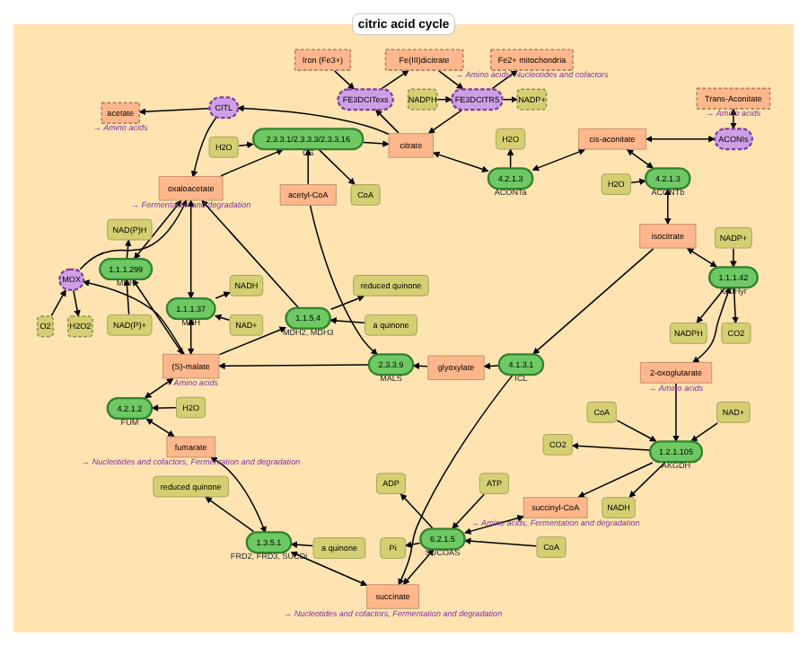 | 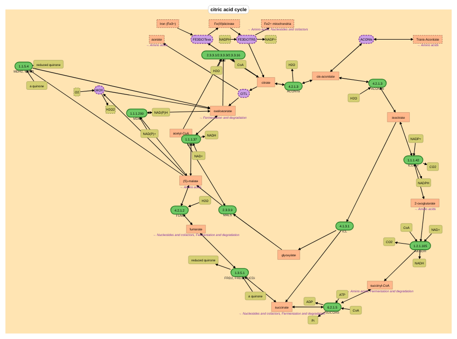 |

### 1.4 Condensing a subsystem (step 4)

Alternating x/y 1D compaction solved as an LP (scipy, HiGHS): nodes whose extents overlap in the other axis keep their
order with a minimum gap; nodes closer than 150 units in the other axis keep their order; objective
Σ|pᵢ − s·pᵢ⁰| + 0.5·n·extent, i.e. a uniform shrink by a factor s plus individual moves that close larger holes.
This is the idea of VPSC/PRISM overlap removal (keep the relative layout, remove space). The extents of the nodes
include room for what is drawn next to them: the model reaction IDs below enzyme nodes of the BRENDA map (SVG), and
for an enzyme node with k model reactions (k − 1) × 24 units across its reactions (`lane_room`: wider if its main
metabolites are above and below it, else higher), where the Escher map draws the reactions side by side (section 5).
The drawn boxes keep their size. For iML1515 (before the room for model reactions was added), free
compaction (no order band) gave −52% area but +20% crossings of main-metabolite links inside the subsystems; full order
preservation −29% area, +3% crossings; the band of 150 −44% area, +8% crossings. After the conservative placement of
step 3b (`--relayout place_conservative`), a subsystem whose links would cross more often after condensing is
condensed again with all nodes in their order along both axes and, if that also adds crossings, not condensed at all
(`condense_subsystems(keep_crossings=True)`); on iML1515 condensing then added no crossing (57 before).

**Uniform shrink (`--uniform-shrink`).** Condensing moves the nodes of the BRENDA drawing individually (citric acid
cycle of iML1515: scale 0.94 in x and 0.65 in y, and moves of up to 99 and 68 units on top of that), while a
subsystem that is not condensed (see above) stays as BRENDA drew it. With `--uniform-shrink`, the subsystems of
`place_conservative` and `place_template` are not condensed but only shrunk by one factor per axis
(`layout.shrink_uniform`): the positions of the enzyme and main metabolite nodes are multiplied by the factors,
cofactor nodes keep their offsets to their enzyme node. The factors (steps of 0.01) are those with the smallest
drawing at which each two nodes (not an enzyme node and its cofactors) still have the gaps of condensing (22 units
in x or 28 in y, with the same room); two nodes that are closer already do not come closer along an axis along which
they are apart; factors with which more links cross or pass through a node are not taken. As the closest two nodes of
a drawing limit the factor, this saves little: on iML1515 (GUI project `iML1515_v4`, 100 subsystems) the boxes take
123.8 M units² (not condensed: 132.5, condensed: 95.4), 32 subsystems are not shrunk at all (among them the citric
acid cycle, where cofactors of the parallel malate dehydrogenases are next to the other enzyme node), the median
factors are 0.94 (x) and 1.00 (y).

### 1.5 Arrangement of the subsystems (step 6)

The subsystems are fixed boxes with "ports" (the linked metabolite nodes inside them). An arrangement is encoded as a
sequence pair (Murata et al. 1995, VLSI floorplanning), which always gives an overlap-free, packed placement.
Simulated annealing (numba kernels, 1.5–2.5 minutes for 200,000 moves with about 100 subsystems) minimises

`crossings + 0.5·link–box crossings + 0.02·link length/mean box size + 100·area/Σ box area + 200·log(aspect/1.6)²`

with moves: swap two boxes in one sequence, exchange the places of two boxes, optionally mirror a box. It starts from
the original BRENDA arrangement.

### 1.6 Edge routes around nodes (step 7)

A straight edge can pass through another node of its subsystem and look as if it joined it, especially after a
`dot` layout in step 3b (`dot` routes long edges around the nodes of the layers between, which the straight edges do
not show) and condensing. Before the outputs are written, Graphviz `neato -n2` routes the main edges of each
subsystem around the node boxes with the final node positions (`splines=true`, in processes of their own); edges
that pass through another node take their route (cubic Bezier curves), all others stay straight. The SVG draws the
routes as paths; in the Escher map, the segment from the multimarker to the metabolite becomes the cubic curve
closest to the route (reactions moved by the Escher export, section 5, keep straight segments).

In iML1515, 465 of the 2,392 main edges passed through other nodes (139 of the 551 in the 14 subsystems
laid out with `dot`); routed, none does.

| Methionine metabolism (`dot`): straight edges | Edges through other nodes routed around them |
|---|---|
| 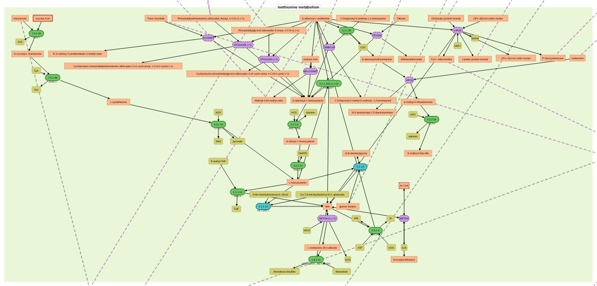 | 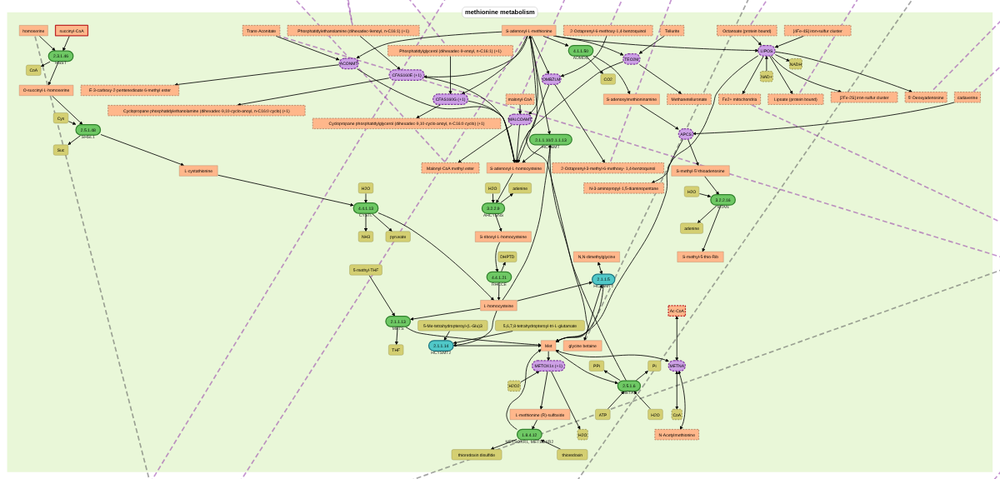 |

## 2. Layout tools

Arrangement of the subsystem boxes (step 6) and compaction (step 4):

| Tool | Fit for this task | Tried |
|---|---|---|
| **Sequence-pair annealing** (here, Python and numba) | Optimises exactly the wanted objective (crossings of links between fixed drawings with fixed ports, link–box crossings, area); keeps the drawings of the subsystems | yes – used |
| **scipy / HiGHS LP** | Order-preserving compaction (VPSC-like) of nodes and boxes | yes – used |
| Graphviz `neato`/`fdp`/`sfdp` (+ VPSC overlap removal) | Places boxes by stress/forces on the box graph; ignores ports, no crossing objective. `prism` overlap removal needs GTS (not in Ubuntu's build nor in the pygraphviz wheels) | yes – 2.3× (neato) to 5.5× (fdp) more crossings |
| ELK (elkjs) `layered` with `FIXED_POS` ports | Sugiyama with real crossing minimisation and fixed port positions, but forces a layered flow; large area. Its orthogonal/polyline edge routing (and libavoid in ELK) is useful for routing inter-pathway links | yes – 4.4–6× more crossings |
| ELK `stress`, `rectpacking` | stress ignores sizes and ports; rectpacking packs boxes without edges | stress – poor |
| OGDF (C++, `ogdf-python`) | Strongest library for crossing minimisation (planarisation, cluster planarity, orthogonal layouts); does not keep given drawings, could arrange the box graph | not for the boxes (see below for subsystems) |
| Tulip (used by CBMViz in this repository) | Bundles OGDF layouts and graph hierarchies, scriptable in Python; tulip-python needs Tulip binaries, which are no longer provided | no |
| adaptagrams (libcola, libvpsc, libavoid) / WebCola | Constraint-based layout with alignment/separation constraints, VPSC overlap removal and libavoid object-avoiding connector routing: best candidate for routing inter-pathway links around boxes and for alignment constraints inside subsystems | no |
| Cytoscape.js `fcose` / Cytoscape (yFiles layouts) | Compound nodes (subsystems) with constraints; yFiles (commercial, free in yEd) has the best grouped hierarchical/orthogonal layouts | no |
| igraph / networkx | No boxes or ports for the arrangement | no |
| Metabopolis (Wu et al. 2019) | Published method closest to this scheme: pathways as blocks, inter-pathway links minimised, orthogonal routing in channels ("urban map") | no implementation available |
| Escher | Editing target (no automatic layout); its builder draws a new reaction along a straight axis with Bezier curves to the metabolites | export, in the builder's drawing style (section 5) |
| Graphviz `circo` | Circular layout (biconnected components on circles); the citric acid cycle: 20 crossings of main-metabolite links (`spring`: 0) | yes – own circular layout instead (`--circle`, 1.3) |
| Graphviz `neato -n2` with `splines=true` | Routes edges around nodes with the node positions fixed | yes – used for edges through nodes (1.6) |
| BioEMMA (KEGG KGML → Escher) | Puts the multimarkers on a straight reaction axis a fraction of the way to the main metabolites and the secondary metabolites next to them; straight segments (version 0.4.3 on PyPI) | code read; its multimarker placement is used in the Escher export |

Layout inside the subsystems with added reactions (step 3b): the 59 subsystems of iML1515 with added reactions, each
laid out after step 3 and condensed as in step 4 (measured before the room for model reactions, 1.4, was added);
crossings of main-metabolite links / of all links, sum of the box areas:

| Tool (install) | Layout | Crossings | Box area |
|---|---|---|---|
| – | current (step 3) | 1,112 / 1,717 | 63 M |
| **networkx** (pip, pure Python) | **spring, BRENDA nodes fixed** | 396 / 732 | 61 M |
| **Graphviz via pygraphviz** (pip, Graphviz included) | **`fdp`, BRENDA nodes pinned** | 460 / 713 | 60 M |
| | `neato` / `neato` Kamada–Kawai, pinned | 864 / 1,692, 653 / 1,303 | 69 M |
| | **`dot`** (Sugiyama) top-down / left-right | 471 / 734, 574 / 920 | 78 M, 74 M |
| | **`neato`, free, starting from the current drawing** | 327 / 681 | 74 M |
| | `sfdp`, free | 400 / 840 | 71 M |
| OGDF via `ogdf-python[quickstart]` | Sugiyama (optimal ranking, median heuristic, optimal hierarchy layout) | 518–529 / 820–839 (two runs) | 71–72 M |
| igraph (pip) | `layout_sugiyama` (no node sizes) | 2,065 / 2,740 | 69 M |
| grandalf (pip, pure Python) | Sugiyama | 904 / 1,358 | 72 M |
| networkx | Kamada–Kawai, ForceAtlas2, ARF (all nodes free) | more crossings than spring; disconnected parts drift apart | |

The layouts are complementary: per subsystem the best of the four layouts in bold (with the 25% margin for `dot` and
free `neato`, see 1.3) gives 242 crossings in this comparison, 245 in the pipeline then (250 with the room for model
reactions). OGDF's Sugiyama layout (the one
CBMViz uses through Tulip) is no better than Graphviz `dot` here and harder to install: `ogdf-python` builds two cppyy
packages from source (7 minutes, needs a C++ compiler; 140 MB of wheels), and objects passed to OGDF must not be freed
by Python (segmentation faults otherwise). Sugiyama layouts route long edges with bends, which the straight edges of
the SVG and the Escher map do not show.

## 3. Results on iML1515

Input: iML1515 from BiGG, matched with vicinity search `propagate`: 714 of 2,375 non-boundary reactions are on 815 of
2,848 enzyme nodes in 115 of 193 subsystems.

Redundant subsystems (1.1): rule A removed 11 subsystems with 1–2 model reactions each (e.g. CDP-diacylglycerol
biosynthesis ⊂ lipid metabolism, glycogen biosynthesis ⊂ degradation of hexoses, ornithine metabolism ⊂ acetate
fermentation, tropane alkaloid biosynthesis ⊂ polyamine pathway). Rule B removed butanoate fermentation, aerobic
toluene degradation, C4 and CAM carbon fixation and the methylaspartate cycle, whose 3–11 reactions are all drawn in
subsystems with reactions of their own (the methylaspartate cycle's in the citric acid cycle, propionate
fermentation, alanine metabolism and the CO2 fixation in Crenarchaeota). Rule C set aside acetyl-CoA biosynthesis
(the same reaction as the oxidative decarboxylation of pyruvate, PDH, which has no other reaction); rule D
photosynthesis (12 of 13 reactions in glycolysis, gluconeogenesis and the pentose phosphate pathway; the 13th, `FBA3`,
is added by the completion, see 4). The [set-aside map](BRENDAmap/draft_map_iML1515/set_aside.svg) in
`BRENDAmap/draft_map_iML1515` is from before rule B and has these 2 subsystems and the 4 removed by rule B, 6
subsystems with 38 model reactions:

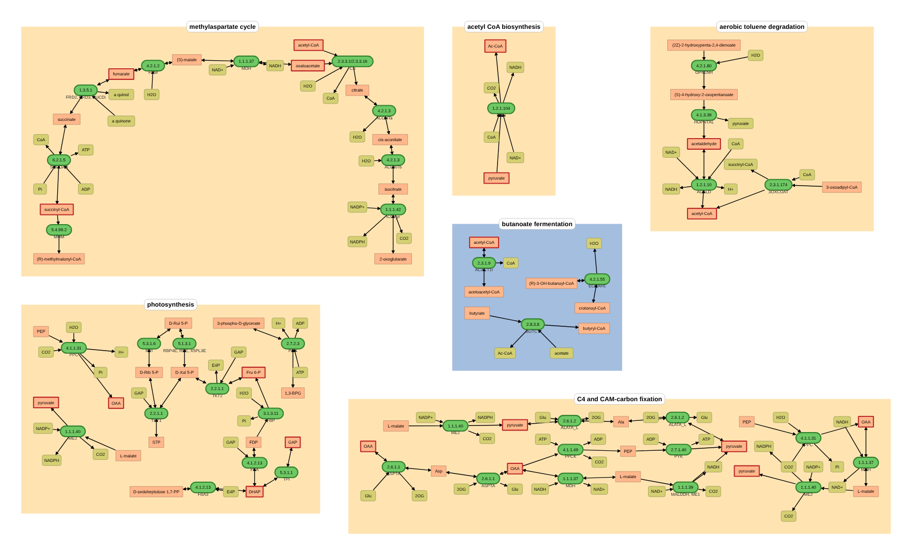

### 3.1 Map after each step

| | subsystems | enzyme nodes | main metabolite nodes | cofactor nodes | model reactions | inter-pathway links |
|---|---|---|---|---|---|---|
| BRENDA map | 193 | 2,848 | 2,818 | 6,257 | – | 234 |
| step 1, subsystems with model reactions | 115 | 1,943 | 1,876 | 4,138 | 714 | 161 |
| step 1, rules A–D (2 set aside) | 100 | 1,768 | 1,687 | 3,751 | 714 | 149 |
| step 2 (before rule B: 104 subsystems, 6 set aside) | 104 | 800 | 941 | 1,603 | 714 | 109 |
| step 3 (before rule B) | 104 | 1,073 | 1,196 | 1,969 | 1,010 | 205 |
| step 5 (hubs ≥ 6), without the set-aside subsystems | 98 | 1,033 | 1,144 | 1,891 | 1,010 | 150 |

Step 3 added 297 of 791 candidate reactions on 273 enzyme nodes, 159 nodes of metabolites not on the map and 96
linked nodes of metabolites drawn in other subsystems. 217 of them connect 2 metabolites that were already drawn,
76 connect 3–5.

Step 3b laid out the 59 subsystems with added reactions again and kept the current drawing in 7, `spring` in 13,
`fdp` in 16, `dot` in 14 and `neato` in 9 of them. Crossings of main-metabolite links in these subsystems (after
condensing): 1,154 → 250 (−78%), e.g.:

| Subsystem | added / all enzyme nodes | without step 3b | with step 3b | layout kept |
|---|---|---|---|---|
| arachidonate biosynthesis | 18 / 23 | 81 | 22 | `fdp` |
| lipid A biosynthesis | 29 / 40 | 140 | 43 | `spring` |
| lipid metabolism | 20 / 48 | 95 | 17 | `neato` |
| vitamin B12 metabolism | 15 / 23 | 190 | 63 | `spring` |
| purine metabolism | 8 / 77 | 76 | 7 | `fdp` |

| Without step 3b (lipid A biosynthesis, arachidonate biosynthesis) | With step 3b |
|---|---|
| 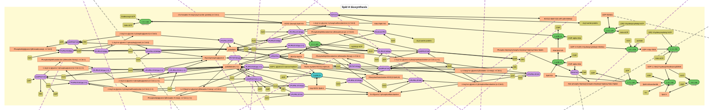 | 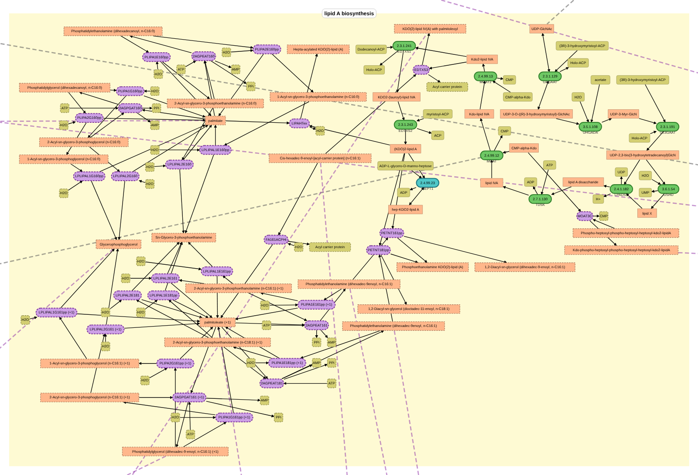 |
| 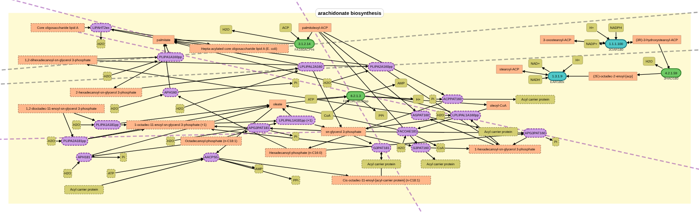 | 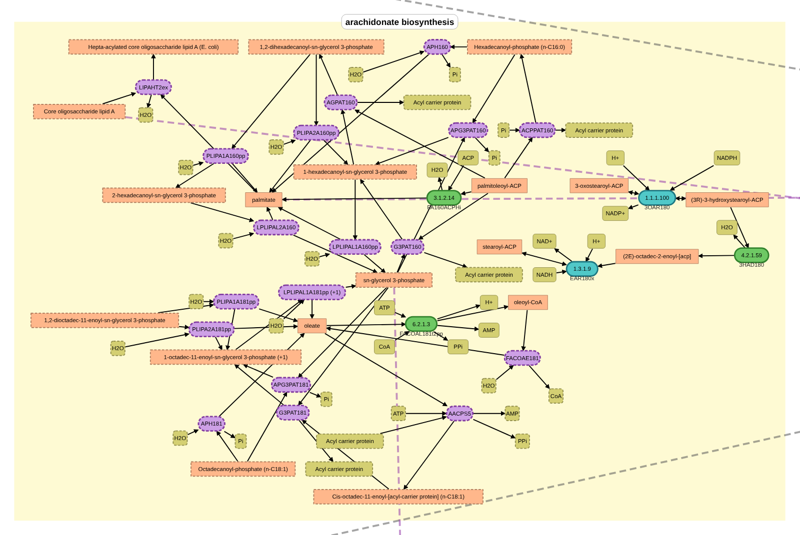 |

Step 4 (sum over the subsystems; in parentheses without step 3b):

| | before | after |
|---|---|---|
| drawing area | 145.8 M units² (115.1 M) | 71.4 M, −51% (65.2 M) |
| overlapping nodes | 26 (7) | 0 |
| crossings of main-metabolite links inside subsystems | 226 (1,029) | 250, +11% (1,154) |
| crossings of all links (incl. cofactors) | 383 (1,466) | 490, +28% (1,803) |

Coverage: 2,712 reactions = 337 boundary + 768 transporters + 1,607 others; the draft map shows 1,010 of the 1,607
(63%; 713 from the map, 297 added; the same reactions as without rules A–D). By model subsystem e.g. citric acid cycle 14/14, pentose phosphate pathway 12/12,
glycolysis/gluconeogenesis 20/23, histidine 10/10, cysteine 12/14; glycerophospholipid metabolism 74/246 (chain-length
variants), murein recycling 8/33, murein biosynthesis 0/15, "Transport, Inner Membrane" 1/23.

### 3.2 Hub metabolites

Metabolites drawn in ≥ 6 of the remaining subsystems (subsystems / inter-pathway links): pyruvate 24/7, acetyl-CoA
19/9, GAP 12/4, F6P 8/6, L-serine 8/6, oxaloacetate 8/3, DHAP 8/2, chorismate 7/5, L-glutamate 7/2, GTP 6/4,
fumarate 6/3, succinyl-CoA 6/3, acetaldehyde 6/1 — 55 of 205 links.

### 3.3 Arrangements

Inter-pathway link crossings / link–box crossings / area ÷ Σ box area; seed 1, 200,000 moves
([arrangement_experiments.json](BRENDAmap/draft_map_iML1515/arrangement_experiments.json); its `fin_hub*` entries are
the runs with 4 seeds, `x`: with left–right mirroring). These comparisons were made before rules A–D, with all 115
subsystems:

| hubs disconnected | links | original order, compacted | **annealed** | annealed, mirrored (x, y) | arrange, then condense | Graphviz neato | Graphviz fdp | ELK layered | ELK stress |
|---|---|---|---|---|---|---|---|---|---|
| none | 212 | 1321 / 313 / 2.77 | **449 / 184 / 2.20** | 360 / 166 / 2.10 | 706 / 257 / 3.13 | 1863 / 595 / 3.89 | 1625 / 1018 / 2.69 | 2084 / 586 / 3.06 | 1827 / 790 / 3.90 |
| ≥ 8 subsystems (7) | 174 | 984 / 264 / 2.77 | **223 / 117 / 1.89** | 148 / 90 / 1.95 | 360 / 173 / 2.57 | 908 / 530 / 3.24 | 1114 / 779 / 2.84 | 983 / 282 / 3.85 | 1190 / 673 / 4.35 |
| ≥ 6 subsystems (14) | 153 | 880 / 236 / 2.77 | **173 / 82 / 2.07** | 126 / 91 / 2.16 | 276 / 145 / 2.54 | 813 / 422 / 3.10 | 889 / 634 / 2.76 | 1040 / 270 / 2.56 | 806 / 620 / 3.48 |
| ≥ 5 subsystems (21) | 139 | 752 / 216 / 2.77 | **102 / 69 / 1.96** | 90 / 68 / 1.88 | 223 / 114 / 2.35 | 496 / 320 / 3.35 | 780 / 706 / 2.52 | 529 / 193 / 3.37 | 536 / 322 / 4.20 |

The Graphviz columns use Graphviz's default edge lengths; `--extra graphviz` sets them from the box sizes, which gives 406 / 145 / 2.32 (neato) and 950 / 701 / 2.65 (fdp) for hubs ≥ 6. Over 4 seeds (hubs ≥ 6): 148–173
crossings without mirroring, 121–138 with left–right mirroring.

Final map (98 subsystems after rules A–D, step 3b): hubs ≥ 6, no mirroring, seed 2: **141 crossings (−84% vs. 878
in the original order), 79 link–box crossings (−71% vs. 272), area 1.86 × Σ box areas (original order: 2.28), 14,100 ×
10,640 units**. Seeds 1–4 gave 141–204 crossings and 79–113 link–box crossings; seed 2 has the lowest annealing cost.
Without step 3b, the same settings gave 192 crossings, 105 link–box crossings and 16,270 × 9,850 units. Before the room
for model reactions (1.4) was added, seed 3 gave 162 crossings, 83 link–box crossings and 13,820 × 9,950 units; with all
115 subsystems (no rules A–D, no step 3b) 149 crossings, 87 link–box crossings and 15,870 × 9,350 units.

| Original arrangement, compacted | Draft map: glycolysis, pentose phosphate and Entner–Doudoroff pathways |
|---|---|
| 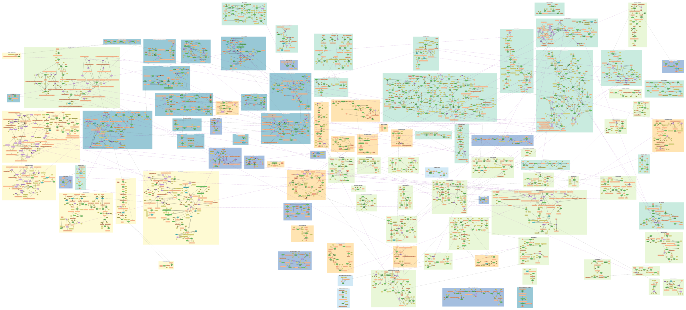 | 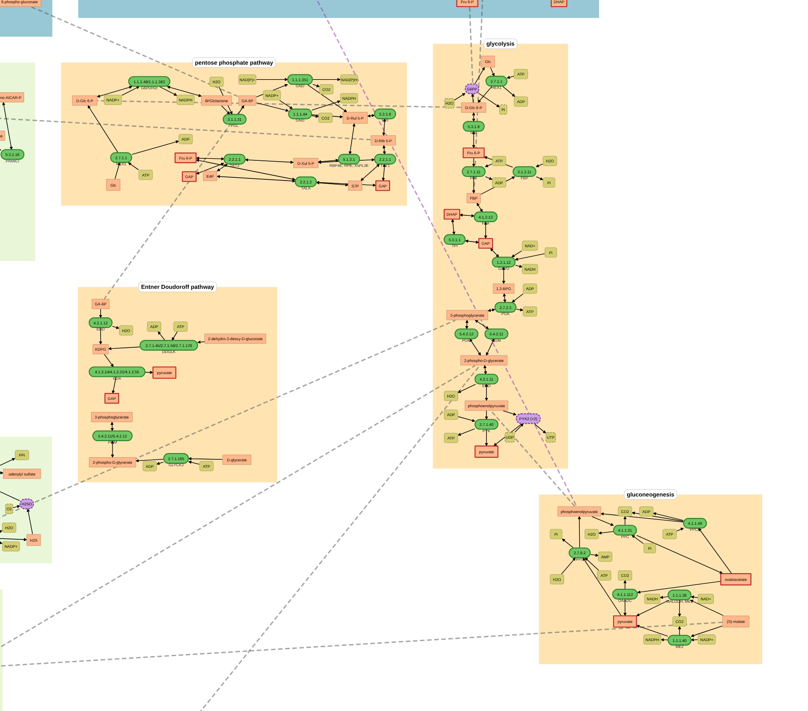 |

### 3.4 Packed without inter-pathway links (`--pack`)

[BRENDAmap/draft_map_iML1515/packed](BRENDAmap/draft_map_iML1515/packed): 200,000 moves, 4 seeds (area 1.218–1.234 ×
Σ box areas, about 15 s per seed). One edge of the BRENDA map crosses subsystems for iML1515 (sarcosine oxidase in
creatinine degradation to glycine in threonine metabolism; removed, glycine is drawn in creatinine degradation too).

| | width × height (units) | area ÷ Σ box area |
|---|---|---|
| original order, compacted | 20,269 × 9,086 | 2.28 |
| arranged for few crossings (hubs ≥ 6, the map of 3.3) | 14,096 × 10,644 | 1.86 |
| **packed** | **12,382 × 7,952** | **1.22** |

The packed map needs 34% less area than the map arranged for few crossings and 47% less than the original order
(`--gap`, 80 units between the boxes, makes it smaller still). The packing does not consider which subsystems belong
together: glycolysis, gluconeogenesis, the pentose phosphate pathway and the citric acid cycle are spread over the map.
The map has the same subsystems, nodes and reactions as the map of 3.3, and the same set-aside map; its Escher map
passes the same checks.

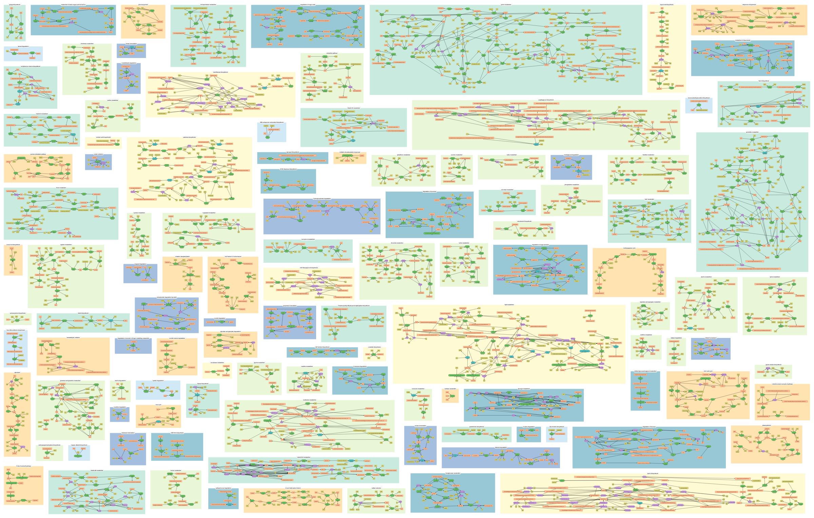

### 3.5 Split into a central map and auxiliary maps (`--split`)

Maps for genome-scale models get large. `--split` makes a central map and auxiliary maps, each a draft map of its own,
and an overview:

- **Central map:** the subsystems of `--central`, by default glycolysis, gluconeogenesis (with the anaplerotic
  reactions), the pentose phosphate and Entner–Doudoroff pathways, the oxidative decarboxylation of pyruvate, the
  citric acid cycle (with the glyoxylate shunt), oxidative phosphorylation and the acetate, ethanol and lactate
  fermentations.
- **Auxiliary maps:** one per colour group of the BRENDA map (the colours of the subsystem boxes), named after their
  subsystems: energy and C1 metabolism (`pw1` without the central subsystems), lipids (`pw2`), amino acids (`pw3`),
  nucleotides and cofactors (`pw4`), carbohydrates (`pw5`), fermentation and degradation (`pw6`), other pathways
  (`pw7`, `pw0`). Maps with fewer than `--min-map-reactions` model reactions are merged into the map they have most
  inter-pathway links with. `--maps` defines further maps.
- **References:** an inter-pathway link between two maps is replaced by a label "→ map names" below both ends, in
  the SVG and as an Escher text label. The references are made from all links, those of hub metabolites included;
  `--hub-subsystems` then removes the hub links inside the maps before arranging them.
- **Set-aside subsystems** (1.1) are the last map, "Set aside".
- **Arrangement:** each map is arranged as in 3.3, with its own links (with `--pack`: packed without links).
- **Overview** (`overview.svg`): one region per map, each subsystem collapsed to a small box with its number of model
  reactions; the boxes keep the relative order they have on their map (sequence pair of their centres, packed). The
  regions are arranged with few crossings of the links between maps (annealing as in 1.5). Grey lines: links inside
  a map, purple: between maps (width by the number of links, hub links left out).
- **Editing the assignment:** `--write-assignment FILE.xlsx` writes the assignment after step 3 (and the merging of
  small maps) and stops, after a few seconds. Sheet *Subsystems*: one row per subsystem, one column per map, an `x`
  marks a map of the subsystem; a row without `x` leaves the subsystem out, a row with several draws the subsystem
  on each of these maps (on the first one with its ID, on the others as a copy `ID@map` with the links of the
  original: inside the map, or references to the maps of the other ends), a new column is a new map (the order of
  the columns is the order of the maps). Sheet *Reactions*: one row per model reaction (no boundary reactions)
  with ID, name, equation (IDs and names), EC numbers, model subsystem and, editable, the IDs of the subsystems in
  which it is drawn (`;`-separated). Removing an ID takes the reaction out of that subsystem (an empty cell: not
  drawn); adding one draws it there as well, as in the completion (step 3: connected to the metabolites drawn in the
  subsystem, new nodes for the others). With subsystems on several maps, the reaction is on each of them.
  Reactions added from the model (step 3, not on the BRENDA map) are purple, as their nodes in the SVG; a light
  purple *Drawn as* marks a reaction on the BRENDA map that is also added in another subsystem. Run again
  with the same prepared model and options of steps 1–3 and `--assignment FILE.xlsx`; the changes are applied
  right after step 3, subsystems left without enzyme nodes are dropped. Both options together write the table of
  the edited assignment (to check it). The optional sheet *Arrangement* (`Map, Subsystem ID, x, y`: top left of
  the box in map units, written by the GUI) holds the arrangement of maps arranged by hand: a map with the
  positions of all its subsystems is drawn so instead of annealed (boxes closer than `--gap` are moved apart as
  little as possible, keeping their order); a map lacking positions is arranged by the pipeline (with a warning).

  ```bash
  python -m ecmapper.draft_map.run PREP.pkl BRENDAmap/BRENDA_map_reactions.json BRENDAmap/BRENDA_map.svg OUT \
      --split --pack --write-assignment assignment.xlsx
  # edit assignment.xlsx, then
  python -m ecmapper.draft_map.run PREP.pkl BRENDAmap/BRENDA_map_reactions.json BRENDAmap/BRENDA_map.svg OUT \
      --split --pack --iterations 200000 --seeds 4 --assignment assignment.xlsx
  ```

- **GUI:** `python -m ecmapper.draft_map.gui` edits the assignment of the subsystems to the maps and their
  arrangement in a window (qtpy with a Qt binding such as PyQt6: `pip install -e "./ecmapper[draft-map,gui]"`).
  It works on **projects**: a project file (`PROJECT.ecmap`, a zip file) holds everything of a task, namely
  - `project.json`: the options of `run` (and `--vicinity`), the files of the project, the template;
  - `model/`: a copy of the model (SBML; JSON, YAML or MAT by the extension; also compressed: `.gz`, `.bz2`,
    `.xz` or a `.zip` with one model file) and of the JSON model with the subsystems (`--subsystems`);
  - `prep.pkl`: the model matched to the BRENDA map as `prepare` does (`prep.key`: matched again only when the
    model, the subsystems file, the BRENDA map, `--vicinity` or the ecmapper version change, or with *File ▸
    Match model again*);
  - `assignment.xlsx` with `assignment_layouts/MAP` (the AI layouts) and `ai/` (the AI work folders, see 3.6);
  - `gui_cache.pkl`: the condensed subsystems (see below), so a project opens in seconds;
  - `template/`: the BRENDA map, only if it is not the one of `BRENDAmap/` (that one is referenced by its
    SHA-256; a change of it is reported when the project is opened).

  An open project is unpacked into a work folder in the ecmapper cache (`projects/` in `~/.cache/ecmapper`,
  `$ECMAPPER_CACHE`), which is `OUT` below; it is reused while the project file does not change, and *Save* zips
  it again (written to a temporary file first). *File* has *New project…* (Ctrl+N: model or PREP.pkl, subsystems
  file, an assignment table to start from, the BRENDA map, `--pack`), *Open project…* (Ctrl+O), *Open recent*,
  *Save* and *Save as…*; without arguments the window shows these and the recent projects. Arguments start a
  new project:
  - `MODEL [OUT_DIR]`: a model with the BRENDA map of `BRENDAmap/` as template unless `--brenda-json` and
    `--brenda-svg` give another; `OUT_DIR` (default: `MODEL_maps` next to the model) is the folder of the built
    maps;
  - or `PREP.pkl [OUT_DIR]`, or the four arguments of `run`; with the options of `run` (`--split` implied; with or
    without `--assignment`).

  It runs steps 1–4 with the
  options given, so the subsystems have the sizes they have on the final maps; the condensed subsystems are kept
  in `OUT/gui_cache.pkl` for the next start with the same inputs (by content), options, code and reaction sheet
  (R. opacus: about a minute the first time, 2 s then).
  - One tab per map (drag the tabs to reorder the maps; double-click to rename) and one for the subsystems on no
    map. A subsystem is a box of the size of its drawing; zoomed in (from 0.3 screen pixels per map unit, or
    with *Drawings*), its SVG is shown as on the final map, with the references to the other maps. With links
    (no `--pack`), the inter-pathway links between the boxes are drawn.
  - Select with a click, Ctrl+click or a rubber band; drag to move. Cut, copy, paste (Ctrl+X, C, V), *Copy to
    map*, *Move to map* and *Remove from map* move subsystems between maps; a copy pasted on another map is drawn
    on both. Everything can be undone.
  - Boxes never come closer than `--gap`: dragged boxes stop at other boxes and slide along them, pasted ones go
    to the nearest free place (at the mouse pointer or right of the map).
  - *Pack map* anneals the current map as the pipeline does (`anneal_arrangement`, iterations and seeds in a
    dialog, from the current places, with progress and stop); *Original order* places the boxes as on the BRENDA
    map. A map that was moved or packed counts as arranged (✎ on the tab) and is saved in the sheet
    *Arrangement*; *Let the pipeline arrange this map* undoes that.
  - *Find* highlights the subsystems whose name or ID contains the text or with a reaction of that ID, on all
    maps; the panel *Subsystem* lists the model reactions of the selected subsystem (read only; edit the sheet
    *Reactions* to change them), those added from the model in purple as in the table; the boxes give their
    number.
  - *Compare layouts* (Arrange menu, context menu, Ctrl+Shift+K) draws the selected subsystems (up to 10) with each
    layout of step 3b: the drawing of step 3, `place_conservative`, `place`, `spring`, `fdp`, `dot`, `neato`
    (and untangled), the circular layout if the subsystem has a cycle, `autolayout` (1.3; if sbml-autolayout is
    installed, also for subsystems without added reactions); each condensed as in step 4, with its
    crossings, area and the reactions it leaves out, the one used now marked. Computed in the background from the
    drawing before step 3b, which the GUI keeps in its cache (`run --compare-layouts` writes the same as SVGs).
    *Use this layout* draws the subsystem with the layout shown (undoable; a box that now overlaps others moves to
    a free place nearby), *Automatic* with the one step 3b chooses again. The choices are kept in the project as
    `--layout-of` and used by *Build maps*: step 3b computes such a layout as the comparison does
    (`relayout.layout_methods`: e.g. `spring+untangle` with `place` and `spring`, untangled), so the built map shows
    the drawing that was chosen.
  - *Build maps* (Ctrl+B) saves the project and runs `run --assignment` with the same options (output folder,
    default `PROJECT_maps` next to the project file and kept in the project, iterations and seeds of the maps
    arranged by the pipeline in a dialog), shows the log and a summary and opens `overview.svg`.

  ```bash
  python -m ecmapper.draft_map.gui iML1515.xml --subsystems iML1515.json --pack   # a new project
  python -m ecmapper.draft_map.gui PREP.pkl BRENDAmap/BRENDA_map_reactions.json BRENDAmap/BRENDA_map.svg OUT \
      --split --pack --assignment assignment.xlsx
  python -m ecmapper.draft_map.run --project iML1515.ecmap OUT --iterations 200000 --seeds 4
  ```

  `run --project PROJECT.ecmap OUT_DIR` builds the maps of a saved project without the GUI: it unpacks the
  project into a temporary folder and takes its prepared model, BRENDA map, table, AI layouts and options
  (options given on the command line take precedence).

[BRENDAmap/draft_map_iML1515/split](BRENDAmap/draft_map_iML1515/split): `--split --pack`, 200,000 moves, 4 seeds
per map (about 5 minutes). "Other pathways" (7 reactions) was merged into amino acids. 117 inter-pathway links
between maps became references on 209 metabolite nodes (85 metabolites); the links inside the maps are dropped, as
they add little once the maps are small.

| Map | Subsystems | Model reactions | Escher reactions | Width × height | Area ÷ Σ box area | References |
|---|---|---|---|---|---|---|
| Central metabolism | 10 | 83 | 91 | 3,126 × 1,859 | 1.25 | 29 |
| Energy and C1 metabolism | 7 | 40 | 42 | 2,604 × 1,401 | 1.22 | 17 |
| Lipids | 7 | 151 | 159 | 4,652 × 3,305 | 1.17 | 23 |
| Amino acids | 32 | 260 | 285 | 6,637 × 4,122 | 1.17 | 55 |
| Nucleotides and cofactors | 18 | 296 | 305 | 6,287 × 3,973 | 1.16 | 33 |
| Carbohydrates | 15 | 173 | 193 | 4,704 × 2,950 | 1.18 | 36 |
| Fermentation and degradation | 9 | 48 | 49 | 2,745 × 1,598 | 1.29 | 14 |
| Set aside | 6 | 38 | 45 | 2,531 × 1,438 | 1.36 | 2 |
| **all maps** | **104** | **1,010** | **1,169** | | | **209** |

The maps together show the same 1,010 model reactions as the single map; 63 of them are on several maps (BRENDA
draws some steps in several subsystems). Without the set-aside map, 1,124 Escher reactions are drawn, as on the
single map. The maps together need 9.9 × 10⁷ units², about as much as the packed single map (9.8 × 10⁷) and 34% less
than the single map arranged for few crossings (15.0 × 10⁷). Arranged with their links instead (`--split --hub-subsystems
6`, measured before step 3b), the maps had 10 crossings and 14 link–box crossings in total and needed 9.5 × 10⁷
units². All eight Escher maps pass Escher's validator, and Escher 1.7.3 loads them with `iML1515.json` with no
reactions or metabolites missing in the model.

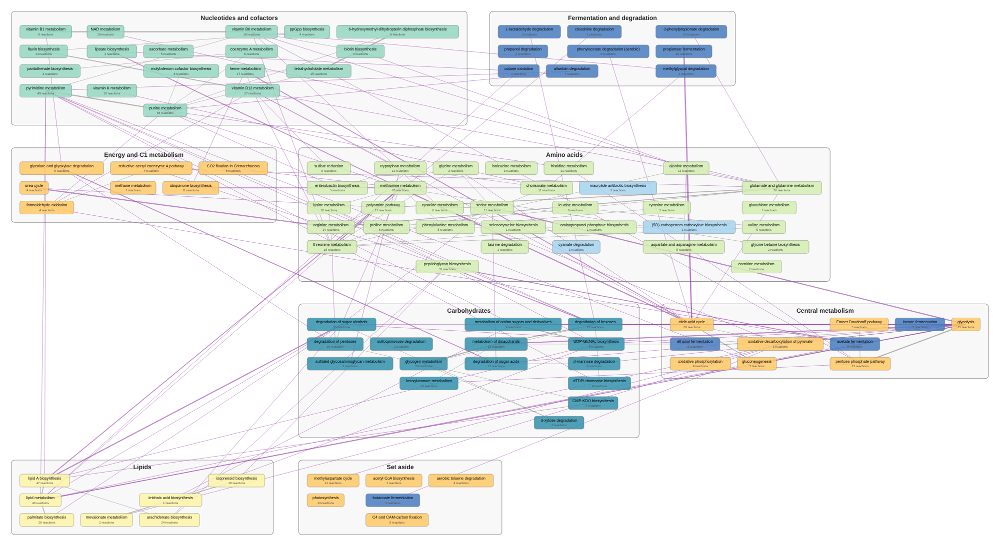

| Central map | Central map in Escher |
|---|---|
| 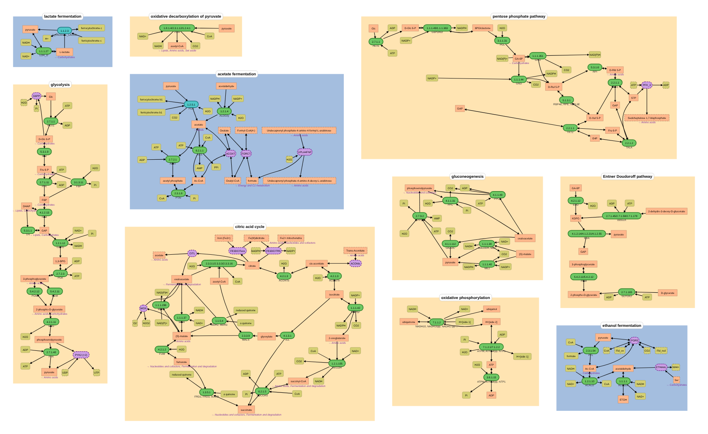 | 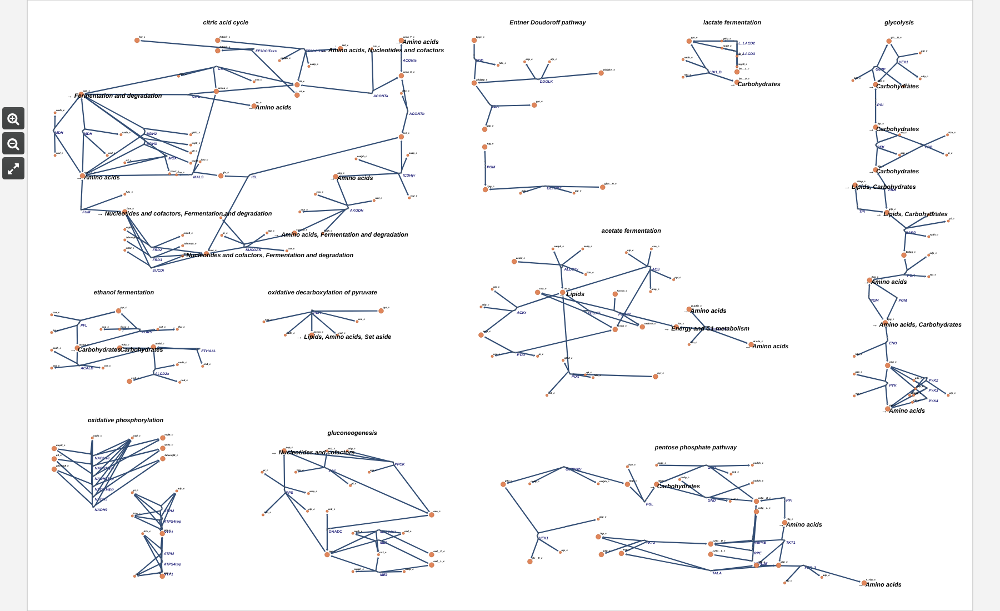 |

### 3.6 AI layouts of whole maps (GUI)

A map of `--split` can be laid out by an AI in the GUI. The AI uses a layout *toolkit*, such as `escher_handlayout_kit`
(shipped in `toolkits/escher_handlayout_kit`) or `escher_handlayout`, and the layout is used for that map from then on.
`toolkits/pwl_handlayout_kit` builds on escher_handlayout_kit for smaller models: the AI gets the subsystems as PWL
texts, the placement of the subsystems from a catalogue of overview maps, and a complete starting spec of the draft
that it only changes (see its README.md).
`toolkits/escher_rules_kit` also builds on escher_handlayout_kit: it judges the layout by a rule set, a YAML file of
typed layout rules that is meant to be edited (`rules/metabolic_map_rules.yaml`). The AI gets the rules that apply to
the map with the places where (`rules_brief.md`), and every build ends with the rules the map breaks (see its
README.md and docs/RULES.md).
The AI lays out all the subsystems of the map together, so it can interconnect them, e.g. merge shared
metabolites into one node (`ai_layouts.py`, `ai/`, `gui/chat.py`).

**Using it:**

- *AI ▸ Lay out with AI…* (Ctrl+Shift+L) opens the chat panel *AI layout* for the current map.
- *AI ▸ Show pre-arranged layout in Escher* (Shift+F7, also in the context menu and the tool bar) shows the current
  map in Escher format as the pipeline pre-arranges it before an AI layout: the map with the current arrangement of
  its subsystems, i.e. the `draft.escher.json` an AI job gets, drawn by Escher (as the AI layouts are, see *Checking a
  submission*) with the outlines of the subsystems. It is read only; Shift+F7 again shows the boxes, F7 the AI layout
  (if any). It is exported again when the map or its arrangement changes. In Python,
  `ai_layouts.draft_layout(m, md, name)` gives this pre-arranged layout of a map (absolute positions, e.g.
  `Session.map_draft(name)`) as a `MapLayout` (`save` writes `final.escher.json`), `Session.draft_info(name)` with
  its SVG and the boxes of its subsystems.
- **Connections:**
  - the Anthropic API (`anthropic` SDK). The default model is `claude-opus-5-5`, with adaptive thinking, a
    selectable effort (default high) and prompt caching. A request the model declines is passed to another model
    (`fallbacks="default"`).
  - OpenAI-compatible APIs (`openai` SDK). Presets cover OpenAI, OpenRouter, Mistral, Gemini, Ollama and LM Studio;
    the model must support tool calls.
  - The key comes from an environment variable, or it is typed in. A typed key is stored with `keyring` if that is
    installed, otherwise it is kept for the session only. Connections are saved without keys.
  - Web chats, see *With a web chat* below.
- **Toolkits:** a folder added with *…*. `escher_handlayout` (v1.0 and v1.1, `python -m escher_handlayout`) and
  `escher_handlayout_kit` (`run.py`: inspect, check-spec, build, validate, directions; the final map is the best build's
  `*_handlayout.json`) are recognised as they are. Other toolkits need a file `ecmapper_toolkit.json`:

  ```json
  {"name": "my_toolkit", "package": "my_toolkit", "instructions": ["PROMPT.md"],
   "commands": ["inspect", "run"], "result": "**/*_final.json", "notes": "how to use it on draft.escher.json"}
  ```

  The files in `instructions` go into the AI's system prompt, and `commands` are the allowed first arguments of
  `python -m package`. An optional `"omit": ["### Step A", ...]` leaves out the sections whose headings start
  with these texts (up to the next heading), e.g. setup steps that only an agent on its own needs.
  escher_handlayout_kit omits its parameters, setup, deliverables and final-message sections.

**A job:**

- **The work folder** is `OUT/ai/MAP/DATE-TIME` (`ai/` of the project, saved with it). It holds the map as the pipeline draws it with the current
  arrangement (`draft.escher.json`), whose subsystem titles serve as zone proposals, and the conversation
  (`transcript.jsonl`).
- **The job record** `ecmapper_job.json` (also in the folders for coding agents) is for toolkits that need more than
  the Escher map:
  - `ids`: the draft objects of the Escher IDs, e.g. `["node", "node1213", "chor_c"]` for a metabolite node or
    `["reaction", "node8437", "EDA"]` for a reaction. The nodes of the BRENDA map keep their node IDs, so these lead
    to the BRENDA map and its PWL descriptions;
  - `subsystems`: the subsystem of every draft node;
  - `template`: the folder of the BRENDA map used;
  - `draft`: the exported map (`draft_vN.escher.json` after *Update with AI*);
  - `kind`: `chat` or `agent`.
- **The AI's tools:**
  - it reads and writes files in the work folder (the toolkit's files are readable as `toolkit/…`);
  - it runs the toolkit (`run_toolkit`, which needs approval, see below);
  - it looks at PNGs, if the model can see images;
  - it submits the final map (`submit_layout`).
- **Checking a submission:** ecmapper accepts the map only if it has the draft's reactions, with their
  stoichiometry, and the same subsystems; otherwise the AI gets the problems back. It maps the positions of the
  draft nodes back by the Escher IDs of the export, following the toolkit's merges in `run_log.json`. Escher
  1.7.3 then exports the map as SVG in a hidden QtWebEngine view; it gets `escher.min.js` from the setting
  `ai/escher_js`, the `escher` package, or a one-time download it asks for. The map's tab shows the result
  (✦; F7 switches between the AI layout and the boxes). One undo step undoes the job.
- **Follow-up messages** refine the layout. *New conversation* continues in the same folder with a fresh context,
  as escher_handlayout's NOTES.md protocol expects.

**Outdated layouts:**

- A change of the map's subsystems or reactions makes its layout outdated (⚠), after asking. *Update with AI*
  gives the AI the map as it is now in `draft_vN.escher.json`, where the objects keep their Escher IDs.
- Changes on other maps only change the "→ map" labels. They are updated when the table is saved, and the SVG is
  exported again.

**With a coding agent** instead of the chat: Claude Code (with your Claude subscription), pi (pi.dev: many providers
through its own logins), Codex or another agent that reads `AGENTS.md`.

- *AI ▸ Prepare folder for a coding agent…* makes a work folder `OUT/ai/MAP/DATE-TIME-agent` with the map
  (`draft.escher.json`), the task as `AGENTS.md` (read by pi, Codex and others when they start there; `CLAUDE.md`
  imports it for Claude Code), `run_toolkit.py` (runs the toolkit with the GUI's Python, the toolkit on the path and
  UTF-8 output) and `ecmapper_job.json` (the map and the draft objects of its Escher IDs). It uses the toolkit chosen
  in the AI dock.
- The dialog shows the commands that start Claude Code (`claude --add-dir TOOLKIT "Lay out this map."`) or pi
  (`pi "Lay out this map."`) there, copies them, or opens a terminal with an agent found on the PATH (Windows).
  Further instructions are given in the agent.
- **Security:** the toolkit runs Python code the model wrote. Claude Code asks before it runs commands; pi has no
  permission prompts and runs them (any command) with your rights; run it in a container if in doubt.
- *AI ▸ Use coding agent result* takes the newest final map (`*_final.json`) of the map's newest such folder. It is
  checked like a submitted map and mapped back by the Escher IDs, so all draft nodes are placed. Use it again after
  further changes.

**With a web chat:** a connection of the kind *Web chat* runs the same job through the text of a chat on a web page,
for models you reach only there (`ai/webchat.py`, `gui/webchat.py`). If the chat also offers an API key
(OpenAI-compatible, as Open WebUI and many institutional portals do), that connection is more reliable.

- **How it works:** ecmapper's first message has the task, the toolkit's instructions and the tools with their JSON
  schemas. The model calls tools by writing JSON blocks (`{"tool": NAME, "input": {...}}`) in its reply, and gets
  their results in the next message. The messages are numbered ("ecmapper message N"), and the model ends each reply
  with the line `@@END N@@`. Images (renders) are pasted only by the browser, and only if *Send images* is on.
- **Browser:** a window with QtWebEngine; logins are kept in its profile `ecmapper-webchat`. Log in, open a new
  conversation and click *Start*. ecmapper pastes each message into the chat's input field (the lowest visible text
  field), presses Enter (or clicks the send button), and reads the page until the reply ends with its end line. A
  reply without one can be taken with *Use the reply as it is*. *Stop* in the dock stops waiting.
- **Copy/paste:** a panel in the dock puts each message on the clipboard. Paste it into the chat, copy the model's
  whole reply, and click *Paste reply*. This works with any chat.
- **Terms of use:** use the browser only for chats whose terms allow automated use, e.g. your own or your institute's
  Open WebUI or LibreChat. claude.ai, ChatGPT and Gemini forbid it, so ecmapper does not send messages there in
  the browser. With a subscription to them, use a coding agent (above); copy/paste is fine with any chat.

**Other commands:** *Import Escher layout…* takes a map laid out elsewhere. It is matched by content (reactions by
BiGG ID, metabolites by their reactions) and accepted if it has the map's reactions; a file in a folder prepared for
a coding agent is matched by its Escher IDs. *Discard AI layout* draws the map automatically again.

**Saving and building:**

- The table gets a sheet *AI layouts* (map, folder, source). The folders are `TABLE_layouts/MAP` (in a project
  `assignment_layouts/MAP`), each with `layout.json`, `final.escher.json` and `final.svg`.
- `run --assignment` writes a fitting layout as the map's Escher map and SVG. The positions mapped back give the
  pickle, the CNApy maps and the reaction positions; each subsystem box is the bounding box of its nodes, and the
  boxes may overlap.
- `stats.json` says `arranged_by: "AI layout"`. An outdated layout is not used: the map is drawn automatically, with
  a warning (`ai_layouts_outdated`).
- These SVGs look like Escher's, without the BRENDA links of the automatic maps.

**Security:** toolkits run Python code the AI wrote (escher_handlayout executes the spec), with the user's rights.
Every toolkit command is therefore shown for approval, unless *Run toolkit commands without asking* is checked or a
job is allowed with *Run all of this job*. The file tools only reach the work folder and, read-only, the toolkit.

**R. opacus:**

- The hand layout of the central map in `R_opacus_HANDLAYOUT/central_metabolism/v7_autotrophic`, made outside the
  GUI, still fits the current central map. Imported, it places 279 of the 305 draft nodes by content; the others
  keep their offset from a neighbour.
- `run --assignment` writes it as `central_metabolism.escher.json` (98 reactions) with Escher's SVG.
- `escher_handlayout inspect` proposes 11 zones for the exported central map.

## 4. Evaluation

What works
- The arrangement is compact and keeps linked subsystems together (glycolysis, the pentose phosphate and
  Entner–Doudoroff pathways are next to each other; gluconeogenesis and the citric acid cycle are not near them). Annealing over sequence pairs beats the
  general tools by far because they optimise other things (stress, layers) and cannot use the fixed port positions.
- Disconnecting hubs is the most effective single measure (crossings 449 → 173 with the same annealing) and loses
  little: their nodes stay in every subsystem, marked.
- The subsystems remain recognisable BRENDA drawings, without the unused 58% of enzyme nodes; the arrows show the
  directions of the model.
- Rules A–C (1.1) remove 17 subsystems that only repeat reactions drawn elsewhere (6 of them set aside on their own
  map), so the main map has 59 fewer duplicate Escher reactions, without losing a reaction.
- Step 3b removes 78% of the crossings inside the subsystems with added reactions (1,154 → 250); in 36 of the 59
  subsystems the BRENDA drawing stays as it is (current drawing, `spring`, `fdp`).
- Completion adds 297 reactions, mostly where they belong (phospholipid/LPS reactions in lipid A, CDP-diacylglycerol
  and fatty acid subsystems; cofactor reactions; nucleotide salvage in purine/pyrimidine metabolism; e.g. `PYK2 (+2)`,
  pyruvate kinase with other nucleotides, in glycolysis).

Problems
- Added reactions are placed by drawn metabolites, not by biology: phospholipid turnover lands in "lipid A
  biosynthesis" because palmitate/palmitoleate are drawn there; 17 reactions of "Inorganic Ion Transport and
  Metabolism" (Fe³⁺-siderophore reductases, FMN-dependent monooxygenases) in vitamin B12 metabolism; the Fe³⁺-dicitrate
  reactions `FE3DCITexs` (extracellular) and `FE3DCITR5` in the citric acid cycle (citrate is drawn there);
  `FBA3` (sedoheptulose-1,7-bisphosphate aldolase), drawn only in the set-aside "photosynthesis", is added to
  chorismate metabolism (where E4P and DHAP are drawn), not to the pentose phosphate pathway.
- 58 periplasmic reactions are drawn like cytosolic ones (the BRENDA map has no compartments).
- Subsystems with many added reactions stay busy where many reactions share a metabolite (palmitate and palmitoleate
  in lipid A biosynthesis); `dot` and `neato` (23 subsystems; since the minimum gain of `--relayout-min-gain` only
  where they save at least 3 crossings) change the BRENDA drawing, and step 3b makes the subsystem drawings 9%
  larger. Condensation adds 11% (main) / 28% (all) crossings inside subsystems.
- Generic map metabolites match many model variants (via generic KEGG compounds); the grouping of variants hides
  that, the label shows `(+k)`.
- 79 inter-pathway links still pass through other boxes (straight lines).
- Reactions on several nodes are drawn several times (BRENDA draws some steps in several subsystems); CNApy shows one
  box per reaction (the first node is used).
- Not drawn: 597 non-transport reactions (e.g. many glycerophospholipid chain-length variants, murein biosynthesis,
  where no metabolite of the map matches) and all 768 transporters.

## 5. Escher export

`draft_map.escher.json` (Escher schema 1-0-0, coordinates × 2) leaves out the inter-pathway links and the subsystem
boxes; the subsystem names are text labels (`--escher-no-labels` drops them). Each model reaction of an enzyme node is
an Escher reaction with a midmarker at the node and a multimarker for its substrates and one for its products. Drawn
main metabolites are primary nodes, matched cofactors secondary nodes; metabolites that are not drawn get secondary
nodes next to the reaction; protons are not drawn (they stay in the stoichiometry). There is one Escher node per drawn
node and compartment-specific model metabolite, at the position of the drawn node in the SVG. Metabolite nodes that
continue on other maps (`--split`, set-aside map) get a text label "→ map names".

The drawing follows the SVG: straight lines between the main metabolites and the reactions, cofactors on curved
branches as Escher's builder draws them (`curve_reactions` in `escher.py`, a post-processing step of the Escher map;
the multimarker placement follows [BioEMMA](https://pypi.org/project/bioemma/), which converts KEGG maps to Escher
maps):

- **Axis:** a straight line through the midmarker, along the difference of the directions from the midmarker to the
  centre of the primary products and to the centre of the primary substrates. A reaction with its substrates above
  and its products below runs vertically.
- **Multimarkers** on the axis, 30% of the way to the centre of their metabolites (20–80 units from the midmarker).
- **Main metabolites** (primary nodes) are joined to the multimarkers by straight segments, as the main metabolites
  in the SVG; where the drawn edge is routed around other nodes (1.6), the segment follows the route.
- **Cofactor branches** are cubic Bezier curves. The control point at the multimarker lies on the axis (40% of the
  segment length times the cosine of its angle to the axis, at least a quarter of that, at most 100 units), the one
  at the cofactor 35% of the way from it to the first: a branch leaves the reaction along its axis and bends towards
  its cofactor.
- **Several model reactions of an enzyme node** (e.g. the NADH dehydrogenases, PYK2–4): side by side in lanes 48
  units apart (24 in the draft map, where steps 3b and 4 keep room for them, see 1.4), perpendicular to their common
  axis, ordered by the metabolites they do not share; their labels are stacked next to the lanes.
- **U-shaped reactions:** where BRENDA (or the completion) puts an enzyme node beside its substrates and products
  (seen from the node, they are less than 100° apart), the reaction would make a wide detour through the node (e.g.
  FBP beside PFK, MOX and MDH2/3 beside MDH, PYK2–4 beside PYK). Such a reaction moves towards the line between its
  substrates and products, to 90 units from it (plus half the width of its lanes), or 80%, 60%, ... of the way there:
  the farthest place where its footprint (lanes, multimarkers, the cofactors beside them and the labels) holds no
  other node or label, no more lines of other reactions than where it is, and where its lines pass no more nodes. Its
  cofactors go to the side away from that line. Reactions with the largest detour move first; later ones keep out of
  their footprints.
- **Cofactors that are not drawn** (and those of moved reactions) go next to the multimarker of their side:
  alternately left and right of a single reaction, in a column beside lanes and moved reactions (the outer lanes'
  closest to their multimarkers).
- **Labels:** in the SVG, labels are inside the boxes; in Escher they are next to the nodes and may cover lines. Each
  label goes where it covers the fewest points of lines, nodes and other labels: reaction labels on one of the two
  sides of their lanes, metabolite labels at one of 8 places around their node (primary metabolites first; ties:
  Escher's default, upper right), "→ map" labels right of, below, left of or above their node.
- **"→ map" labels** use short map names (up to the first "and" or comma, e.g. "→ Nucleotides, Fermentation"):
  Escher draws text labels at 50 px, 2.5 times the size of metabolite labels, while the SVG shows them in small type.
- **Scale:** Escher's font sizes and node radii are fixed in map units. At scale 2 its metabolite labels have about
  the size relative to the distances between the nodes that the labels in the SVG have (at 2.5 they look small and
  the map empty; at 1.7 the labels crowd).

The metabolite nodes stay where they are in the SVG, apart from cofactors of moved reactions. In Escher's builder,
the curves can be changed like those of reactions added there.

| SVG (central map, citric acid cycle) | Escher |
|---|---|
|  | 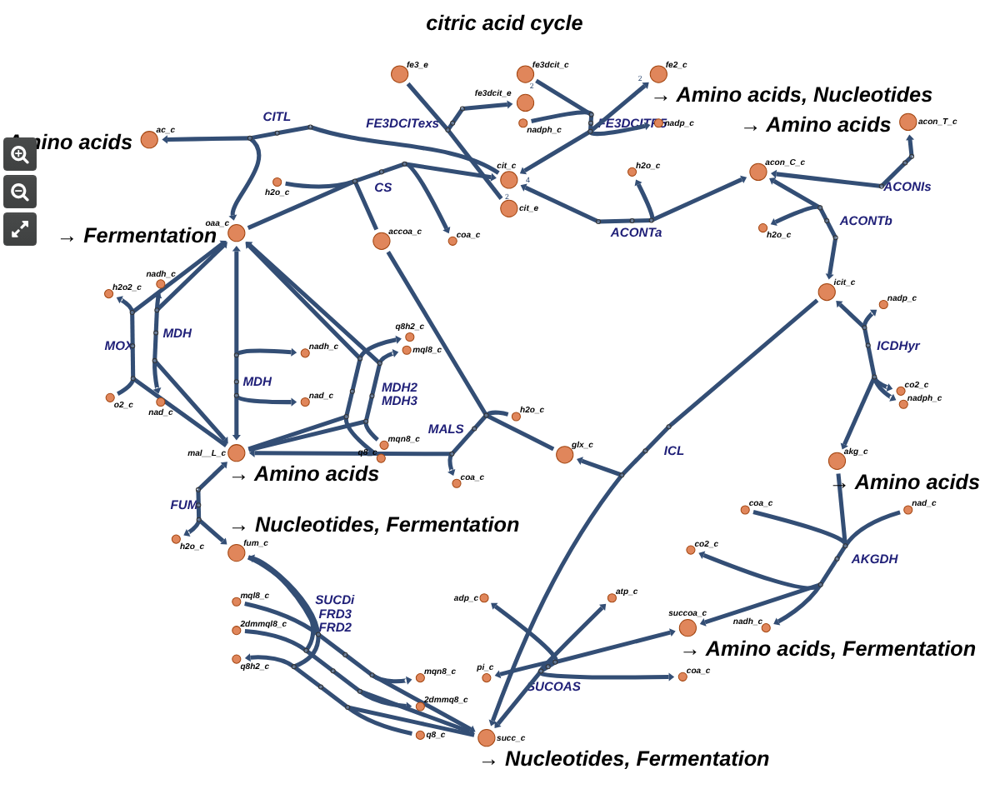 |

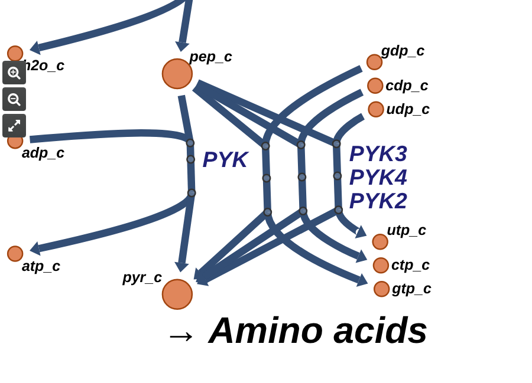

iML1515: 1,124 Escher reactions (1,010 model reactions; reactions on several nodes are drawn several times),
6,544 nodes, 98 text labels, 2,007 curved cofactor branches. 378 Escher reactions are U-shaped; 289 of them moved,
and their summed distance from the line between their substrates and products fell from 89,400 to 55,700 units (−38%;
on the central map of `--split` 23 of 25, 5,000 → 3,300). The set-aside map `set_aside.escher.json` has 45 Escher
reactions (38 model reactions). `escher.validate.validate_map` (escher 1.7.3; schema and consistency of segments,
stoichiometry, genes) passes; Escher 1.7.3 loads it with `iML1515.json` and finds all reactions and metabolites in
the model. The same holds for the set-aside map and the maps of `--split`.

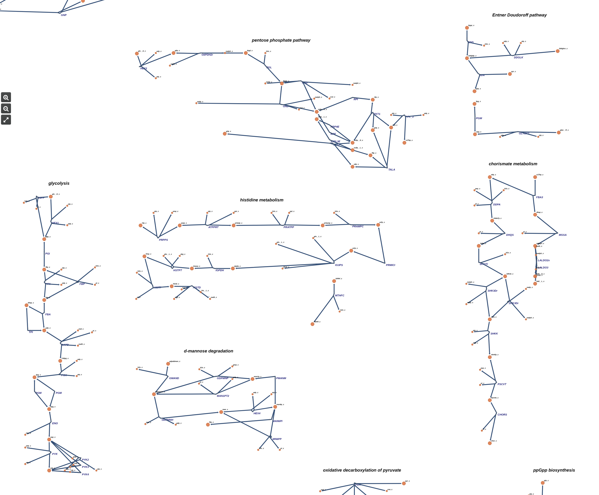

## 6. Next steps

1. Route inter-pathway links around boxes (libavoid or ELK orthogonal routing) and draw them in the Escher map as
   needed.
2. Completion: compartment handling (restrict to the cytosol or add a "periplasm" subsystem), a target-subsystem score
   that also uses the model subsystem, optional new subsystems for groups of added reactions without a good BRENDA
   subsystem (e.g. murein, membrane lipids).
3. Inside subsystems: constraints that keep added reactions near the BRENDA nodes they connect (e.g. WebCola); a
   circular layout of cycles that also arranges the parallel reactions and chords to fewer crossings (1.3).
4. Weights of the annealing as options; keeping the colour groups (category regions) of the BRENDA map together.
5. Semantic zooming in a viewer: collapse subsystems into the boxes of the overview and re-pack the maps with the
   same sequence pairs, which keeps the relative positions.
6. A command of the `ecmapper` CLI; runs on the models of [BRENDA_MAP_EVALUATION.md](BRENDA_MAP_EVALUATION.md).
